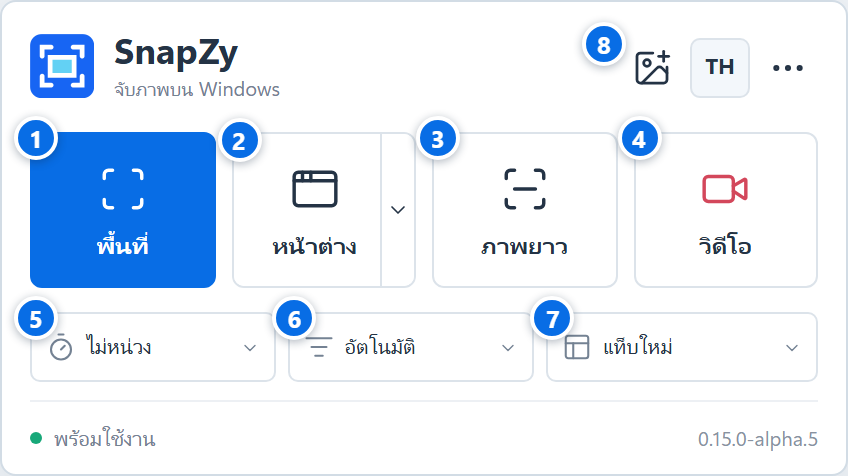
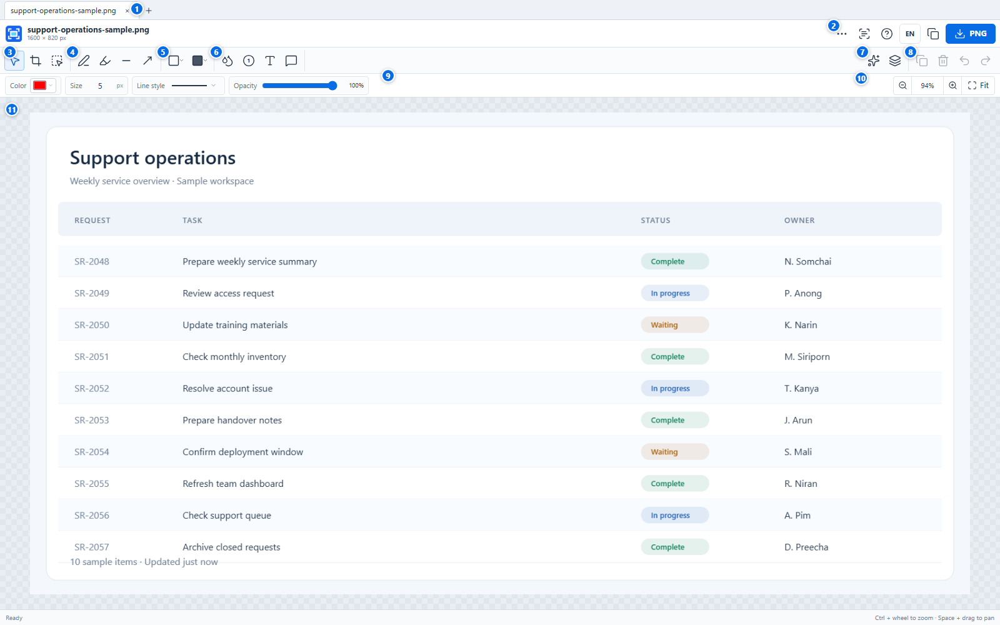

# SnapZy Rust Preview

**Version:** 0.15.0-alpha.5 | **Platform:** Windows 10/11, x64 | **License:** MIT

## Download / ดาวน์โหลด

**Windows 10/11 · 64-bit · Pre-release**

[⬇ Download SnapZy 0.15.0-alpha.5 for Windows](https://github.com/jairlinethai8989/snapzy-rust/releases/download/v0.15.0-alpha.5/SnapZy-Setup-0.15.0-alpha.5-win-x64.exe)

New to GitHub? On the release page, expand **Assets** and choose
`SnapZy-Setup-0.15.0-alpha.5-win-x64.exe`. Open the downloaded file and follow
the setup steps. This pre-release installer is unsigned, so Windows may show a
SmartScreen warning.

สำหรับมือใหม่: กดลิงก์ดาวน์โหลดด้านบน หรือเปิดหน้า Release แล้วกด **Assets**
จากนั้นเลือก `SnapZy-Setup-0.15.0-alpha.5-win-x64.exe` เปิดไฟล์ที่ดาวน์โหลด
แล้วทำตามขั้นตอนติดตั้ง รุ่นนี้เป็นรุ่นทดสอบและไฟล์ติดตั้งยังไม่ได้ลงลายเซ็น
Windows จึงอาจแสดงคำเตือน SmartScreen

SnapZy Rust Preview is an early, standalone Rust implementation for measuring
startup and capture responsiveness against the existing SnapZy Windows app.
It is an experiment, not a claim that Rust is faster. The two applications use
separate settings, process identity, hotkeys and installation locations.

## Tauri Interface

The current [Tauri 2 interface](experiments/tauri/README.md) uses HTML,
CSS and vanilla JavaScript, with no JavaScript UI framework. It connects to the
existing native Rust capture engine. It covers the launcher and image editor,
EN/TH, capture options and command handoff.

หน้าหลักและหน้าแก้ไข Tauri ใช้ HTML/CSS/JavaScript ล้วนใน `experiments/tauri`
รองรับ EN/TH และส่งคำสั่งไปยังระบบจับภาพ Rust เดิม

## User guides / คู่มือผู้ใช้

- [คู่มือภาษาไทย](docs/user-guide-th.md) · [English user guide](docs/user-guide-en.md)
- [หน้าจับภาพ](docs/images/snapzy-launcher-overview.png) · [หน้าแก้ไขภาพ](docs/images/snapzy-editor-overview.png)

| หน้าจับภาพ / Capture launcher | หน้าแก้ไขภาพ / Image editor |
| --- | --- |
| <a href="docs/images/snapzy-launcher-overview.png"></a> | <a href="docs/images/snapzy-editor-overview.png"></a> |

คู่มืออ้างอิง Tauri Editor `0.15.0-alpha.5` และระบุคำสั่งที่ยังไม่เชื่อมต่อในรุ่นนี้ไว้แล้ว

## Features in this preview

### 0.14.0 Alpha 1: Compact Native Interface / หน้าตา Native แบบกะทัดรัด

The launcher now uses a compact 360 x 140 logical-pixel layout with four direct
capture actions, a split Window/Desktop command, direct Open Image and Language
buttons, and a small More menu for secondary commands. The editor uses adaptive
work, tool and context rows: Copy and Save PNG remain directly available while
secondary project, image and layer commands move into short menus when space is
limited.

All launcher and editor commands now use embedded Lucide-style native vector
icons with clear hover, selected, pressed, focused, disabled, primary and
destructive states. Every icon has a localized EN/TH accessible name and a
native tooltip that appears without taking focus. Icon rendering is cached and
scales at 100%, 125%, 150% and 200% DPI.

หน้าหลักปรับเป็นขนาดกะทัดรัด 360 x 140 logical pixels มีคำสั่งจับภาพหลักสี่ปุ่ม
แยกปุ่ม Window/Desktop แบบ split button และมีปุ่มเปิดภาพกับสลับภาษาโดยตรง
คำสั่งรองถูกรวมไว้ในเมนู More ส่วนหน้าแก้ไขจัดเป็นแถวงาน เครื่องมือ และค่าปรับ
แบบยืดหยุ่น โดย Copy และ Save PNG ยังเห็นได้ตลอด ส่วนคำสั่งไฟล์ ภาพ และลำดับชั้น
จะแสดงตรงหรือรวมในเมนูตามพื้นที่หน้าต่าง

ไอคอนหน้าหลักและหน้าแก้ไขเป็นภาพเวกเตอร์ Native แบบ Lucide ที่สื่อความหมายตรง
รองรับสถานะชี้ เลือก กด โฟกัส ปิดใช้งาน ปุ่มหลัก และปุ่มอันตราย พร้อมชื่อและ tooltip
อังกฤษ/ไทยโดยไม่แย่งโฟกัส ไอคอนยังคมชัดที่ DPI 100%, 125%, 150% และ 200%

Local test candidate only; see
[0.14.0 Alpha 1 test notes](docs/testing/0.14.0-alpha.1.md).
No .NET changes, installer, commit or push.

### 0.13.0 Alpha 1: Editable Text And Bubble Import / นำเข้าข้อความและช่องคำพูด

Compatible Neo Snap `.neosnap` version 1 projects now import ordinary text and
speech bubbles as editable Rust objects. The importer retains Thai/English text,
explicit line breaks, anchor, font size up to 256 px, opacity, shadow, text
outline, image ownership and layer order. Speech bubbles additionally retain
their explicit body size, fill, independent border color/width and movable tail.
Imported work can be edited, resized, reordered, undone/redone and saved as a
new `.snapzy` schema 4 project without modifying the `.neosnap` source.

ระบบนำเข้า `.neosnap` รองรับข้อความและช่องคำพูดแบบแก้ไขต่อได้แล้ว โดยรักษา
ข้อความไทย/อังกฤษ การขึ้นบรรทัด ตำแหน่ง ขนาดอักษรถึง 256 px ความโปร่งใส เงา
ขอบอักษร ความสัมพันธ์กับภาพ และลำดับเลเยอร์ ช่องคำพูดยังคงขนาดกรอบ สีพื้น
สี/ความหนากรอบที่แยกจากตัวอักษร และปลายหางที่ลากได้ บันทึกต่อเป็น `.snapzy`
โครงสร้างรุ่น 4 ได้โดยไม่แก้ไฟล์ `.neosnap` ต้นฉบับ

ค่าหรือเครื่องมือที่รักษาได้ไม่ครบยังทำให้หยุดนำเข้าทั้งไฟล์พร้อมคำอธิบาย EN/TH
ไม่มีการตัดวัตถุ ลดค่า หรือแปลงเป็นภาพแบน ความต่างเล็กน้อยของรูปอักษรและการ
ตัดบรรทัดระหว่าง browser canvas กับ Windows ถือเป็นข้อจำกัดที่ทราบแล้ว

Local test candidate only; see
[0.13.0 Alpha 1 test notes](docs/testing/0.13.0-alpha.1.md).
No .NET changes, installer, commit or push.

### 0.12.0 Alpha 1: Editable Step And Blur Import / นำเข้าเลขลำดับและเบลอ

Compatible Neo Snap `.neosnap` version 1 projects can now import numbered
markers and blur regions as editable Rust objects. Position, source size, number,
color, opacity, compatible shadow, image ownership and layer order are retained.
Imported step markers keep the .NET circle-sizing, white-ring and digit-color
rules; imported blur supports the complete 1-64 px source range and 0-100%
opacity. Both tools can be selected, edited, reordered, undone/redone and saved
to `.snapzy` without changing the original `.neosnap` file.

ระบบนำเข้าไฟล์ `.neosnap` รองรับเลขลำดับและพื้นที่เบลอแบบแก้ไขต่อได้แล้ว โดย
รักษาตำแหน่ง ขนาดต้นฉบับ ตัวเลข สี ความโปร่งใส เงาที่รองรับ ความสัมพันธ์กับภาพ
และลำดับเลเยอร์ เลขลำดับคงหลักการกำหนดวงกลม ขอบสีขาว และสีตัวเลขของรุ่น .NET
ส่วนเบลอรองรับความแรง `1–64 px` และความโปร่งใส `0–100%` เลือกแก้ จัดชั้น
Undo/Redo และบันทึกต่อเป็น `.snapzy` ได้โดยไม่เปลี่ยนไฟล์ต้นฉบับ

ไฟล์ที่มีข้อความ ช่องคำพูด หรือค่าที่รักษาได้ไม่ครบยังถูกปฏิเสธทั้งไฟล์พร้อม
คำอธิบาย EN/TH ไม่มีการตัดวัตถุทิ้ง ลดค่า หรือแปลงเป็นภาพแบน ความต่างเล็กน้อย
ที่ขอบตัวเลขและความฟุ้งของเบลอระหว่างระบบวาดภาพถือเป็นข้อจำกัดที่ทราบแล้ว

Local test candidate only; see
[0.12.0 Alpha 1 test notes](docs/testing/0.12.0-alpha.1.md).
No .NET changes, installer, commit or push.

### 0.11.0 Alpha 1: One-Way .neosnap Import / นำเข้างาน .NET ทางเดียว

The existing Open command now accepts compatible Neo Snap `.neosnap` version 1
projects. PNG backgrounds and image layers, pen, highlighter, line, arrow,
outline/filled rectangle and ellipse objects remain editable. Compatible crop,
layer ownership, stroke pattern, opacity and shadows are retained. Imported
freehand paths keep the .NET smoothing rule and imported arrows keep the .NET
arrowhead geometry. Single-point pen marks remain visible and editable.

An imported file opens as an unsaved Rust work item and can only be saved as a
new `.snapzy` project; the `.neosnap` source is never overwritten. New projects
use `.snapzy` schema 3 for source rendering metadata. Schema 1 and 2 projects
remain readable. Text, speech bubbles, step numbers and blur are not supported
by this first import stage. If any object or property cannot be preserved, the
whole import is rejected with an EN/TH explanation; no partial or flattened
fallback is created.

คำสั่ง Open เปิดไฟล์งาน Neo Snap `.neosnap` เวอร์ชัน 1 ที่เข้ากันได้แล้ว
รองรับภาพ PNG ปากกา ไฮไลต์ เส้น ลูกศร สี่เหลี่ยม/วงรีแบบโปร่งและทึบ รวมถึง
ครอป ลำดับวัตถุ รูปแบบเส้น ความเข้ม และเงาที่แปลงได้ครบ เส้นปากกาและหัวลูกศร
คงวิธีวาดแบบรุ่น .NET หลังนำเข้ายังเลือก ย้าย แก้ไข และ Undo/Redo ได้

งานที่นำเข้าถือเป็นงาน Rust ใหม่ซึ่งยังไม่บันทึก และบันทึกต่อเป็น `.snapzy`
เท่านั้น โดยไม่เขียนทับต้นฉบับ `.neosnap` รุ่นแรกนี้ยังไม่รองรับข้อความ
ช่องคำพูด เลขลำดับ และเบลอ หากมีรายการใดแปลงได้ไม่ครบ ระบบจะไม่เปิดทั้งไฟล์
และแจ้งสาเหตุเป็นภาษาอังกฤษหรือไทย ไม่มีการตัดบางวัตถุทิ้งหรือแปลงเป็นภาพแบน

Local test candidate only; see
[0.11.0 Alpha 1 test notes](docs/testing/0.11.0-alpha.1.md).
No .NET changes, installer, commit or push.

### 0.10.0 Alpha 3: Video Preview And Copy / พรีวิวและคัดลอกคลิป

Stop/Esc finalizes the recording and opens an in-app preview instead of an
automatic Save dialog. The clip starts paused. Play/pause, seek, elapsed/total
time, mute and volume use Windows Media Engine, loaded only for playback; no
WebView2 or additional player is bundled. Silent clips disable audio controls.

Copy Clip puts an actual MP4 file entry on the Windows clipboard, ready to paste
into applications that accept pasted video files. Chat support must be tested in
the target application; copying does not send or upload anything. Save MP4 opens
an explicit chooser and exports in the background without re-encoding. Cancel
and failure keep the preview and original. Existing destination files are never
replaced. Show in Folder exposes the retained original for manual file dragging.

Completed originals remain in `%LOCALAPPDATA%\SnapZyRustPreview\Recordings\Pending`
after Copy, Save, preview close and app exit, so copied file paths stay usable.
Save creates another file and therefore uses additional disk space. There is no
automatic cleanup in this increment. Before closing an unkept clip, choose Save,
Keep Local or Cancel; cancelling app exit leaves all video previews open.
Preview playback pauses and hides before a new capture to avoid self-recording.

หยุดอัดด้วย Stop/Esc แล้วเปิดพรีวิวในโปรแกรม โดยเริ่มพักไว้ ไม่เล่นเสียงเอง
มีเล่น/พัก เลื่อนเวลา ปิดเสียงและปรับระดับเสียง ปุ่มคัดลอกคลิปส่งไฟล์ MP4
เข้าคลิปบอร์ดสำหรับวางในแอปที่รองรับ ไม่ส่งข้อความหรืออัปโหลดอัตโนมัติ
ปุ่มบันทึก MP4 จึงค่อยถามชื่อไฟล์ หากยกเลิกหรือบันทึกไม่สำเร็จ คลิปเดิมยังอยู่
สามารถแสดงไฟล์ในโฟลเดอร์เพื่อลากไปวางเองได้ ยังไม่รวมการตัดต่อคลิป

เก็บต้นฉบับไว้ในเครื่องหลังปิดพรีวิวและออกจากโปรแกรม เพื่อให้คลิปที่คัดลอกยังวางได้
การ Save สร้างอีกไฟล์จึงใช้พื้นที่เพิ่ม หากยังไม่ได้ Copy/Save จะถามบันทึก เก็บไว้
ในเครื่อง หรือยกเลิก ไม่มีการลบคลิปเก่าอัตโนมัติในรุ่นทดลองนี้

Local candidate only; see [Alpha 3 test notes](docs/testing/0.10.0-alpha.3.md).
No .NET changes, installer, commit or push. The sections below describe earlier
milestones; Alpha 3 supersedes their automatic Save-after-Stop workflow.

### 0.10.0 Alpha 2: Recording Audio / เสียงในคลิปวิดีโอ

The Video menu offers No audio, System audio (all apps), Microphone, or both.
The initial choice is No audio; an explicit selection is remembered. System
audio captures the default playback device, including other applications even
when recording one window. Microphone uses the default Windows recording device.
Selected audio is encoded as 48 kHz stereo AAC alongside the H.264 video.

Select the audio option, reopen Video and select Record screen/window. Recording
still starts after 3-2-1 and asks for a filename only after Stop/Esc. Audio input
loss stops the clip with a reason; it does not silently switch devices. Cancel
Save keeps the recorded clip. Audio interfaces run only in the recording worker.

เมนู Video เลือกได้ 4 แบบ: ไม่บันทึกเสียง, เสียงจากเครื่อง, ไมโครโฟน และทั้งสองอย่าง
เริ่มต้นไม่บันทึกเสียงและจำตัวเลือกที่ผู้ใช้เลือก เสียงจากเครื่องรวมเสียงทุกแอปที่ออก
อุปกรณ์เล่นเสียงเริ่มต้น แม้จะเลือกอัดเพียงหน้าต่างเดียว ส่วนไมโครโฟนใช้อุปกรณ์เริ่มต้น
ของ Windows เลือกเสียงแล้วเปิด Video อีกครั้งเพื่อเลือกจอหรือหน้าต่างที่จะอัด
ยังคงนับถอยหลังและเลือกชื่อไฟล์หลังหยุดอัด หากรับเสียงไม่ได้จะหยุดและแจ้งสาเหตุ

In-app preview and clip copying remain subsequent stages. Device/driver behavior
and long-duration A/V synchronization require native tester feedback. See
[Alpha 2 audio test notes](docs/testing/0.10.0-alpha.2.md).

### 0.10.0 Alpha 1: Native Video Stage One / บันทึกวิดีโอช่วงแรก

Record one selected monitor or application window to a silent H.264 MP4 at a
target 30 fps. SnapZy prepares the source before a 3-2-1 countdown and records
without an application time limit. Stop from the compact controller, the tray,
or global Esc. Frames stream to disk with bounded memory; recording stops safely
when free space falls below 256 MiB. The destination is never overwritten and a
nonempty partial file is retained when finalization fails.

Select the source to start the countdown immediately. Choose the filename and
destination only after Stop/Esc finalizes the video. Cancelling Save keeps the
recorded clip and shows its recovery location. Large files save in the background.

บันทึกจอที่เลือกหนึ่งจอหรือหน้าต่างโปรแกรมเป็นไฟล์ H.264 MP4 แบบไม่มีเสียง
เป้าหมาย 30 fps มีนับถอยหลัง 3-2-1 และไม่จำกัดเวลาด้วยตัวโปรแกรม หยุดได้จาก
หน้าควบคุม เมนู Tray หรือปุ่ม Esc ระบบเขียนข้อมูลลงดิสก์ต่อเนื่องและจำกัดการใช้
หน่วยความจำ หยุดอย่างปลอดภัยเมื่อพื้นที่เหลือน้อยกว่า 256 MiB ไม่เขียนทับไฟล์เดิม
และเก็บไฟล์ partial ที่มีข้อมูลไว้หากขั้นตอนปิดไฟล์ไม่สำเร็จ

เลือกจอหรือหน้าต่างแล้วเริ่มนับถอยหลังได้ทันที เลือกชื่อไฟล์และที่เก็บหลังหยุดอัด
หากยกเลิกหน้าบันทึก ระบบเก็บคลิปที่อัดแล้วไว้พร้อมแจ้งตำแหน่งไฟล์
การบันทึกคลิปขนาดใหญ่ทำงานเบื้องหลังเพื่อให้โปรแกรมยังตอบสนองได้

This stage does not yet include audio, pause/resume, region recording, in-app
preview, or copying the MP4 to chat. No .NET changes, installer, commit, push,
or public release are included. See
[0.10.0 Alpha 1 test notes](docs/testing/0.10.0-alpha.1.md).

### Alpha 16: Native Document Tabs / แท็บงาน

New captures, images and projects open as independent tabs by default. Choose
New window on the launcher to change future opens without moving existing work.
Each work retains its own tools, selection, Undo/Redo, editable project and cache.
Ctrl+Tab / Ctrl+Shift+Tab cycle tabs in the current window; Ctrl+W closes its
active tab. Long labels truncate; the native strip scrolls when tabs overflow.

Tab close affects one work. Window close offers current tab, all tabs in that
window, or Cancel. Bulk closing collects decisions and successful project saves
before removing any work; cancelling keeps the entire set open. Exit applies to
all editor windows. Already completed saves remain on disk after cancellation.
Copy/PNG is still not an editable project save. Schema 2 remains unchanged.

เปิดภาพใหม่เป็นแท็บโดยค่าเริ่มต้น เลือกหน้าต่างใหม่ได้จากหน้าหลัก การเปลี่ยนค่า
ไม่ย้ายงานที่เปิดอยู่ แต่ละแท็บแยกเครื่องมือและ Undo/Redo ปิดเฉพาะแท็บหรือเลือก
ปิดทุกแท็บในหน้าต่างได้ หากยกเลิกระหว่างถามบันทึก งานทุกแท็บยังเปิดอยู่ครบ
ผล OCR และการบันทึกเบื้องหลังยังผูกกับภาพต้นทาง ไม่ย้ายไปแท็บที่กำลังดู

Local test candidate only. The user reported Alpha 16 testing passed on
2026-10-13 and approved moving to the next stage. Detailed native checks and a
status-label clipping finding remain open; this is not full release certification.
No .NET changes, installer, commit or push.
See [Alpha 16 test notes](docs/testing/0.9.0-alpha.16.md).

### Alpha 15: Editable Image Combination / รวมภาพและแก้ไขต่อได้

Combine two or more open editors into a new independent project. Choose source
order, vertical/horizontal placement with a 0-500 px gap (default 16 px), or free
placement. Native image sizes are retained; the source projects stay unchanged.
Imported annotations remain editable and belong to their source image. Select
an annotation directly, or use Select owning image to move, uniformly resize,
crop or delete the image and its contents together. Layer commands operate
within the same owner. New annotations belong to the overall canvas.

รวมภาพจากหน้าต่างที่เปิดอยู่เป็นงานใหม่ เลือกลำดับ แนวตั้ง แนวนอน และระยะห่าง
หรือจัดวางอิสระ โดยไม่เปลี่ยนงานต้นฉบับ ข้อความและวัตถุเดิมยังแก้ไขได้
เลือกวัตถุโดยตรง หรือกดเลือกภาพเจ้าของเพื่อย้าย ปรับขนาด ครอป หรือลบพร้อมวัตถุ
รองรับ Undo/Redo และบันทึกกลับเป็นไฟล์งาน `.snapzy`

รุ่นนี้เปิดไฟล์ Alpha 14 ได้ แต่ไฟล์ที่บันทึกใหม่ต้องใช้ Alpha 15 ขึ้นไปเปิด
ควรใช้ Save As เพื่อเก็บไฟล์เดิม ไฟล์งานยังเก็บข้อมูลใต้ครอปและเบลอไว้
หากไม่ต้องการส่งข้อมูลที่ซ่อนอยู่ ให้แชร์ภาพ PNG ที่ส่งออกแทนไฟล์งาน

Alpha 15 reads Alpha 14 projects. Newly saved projects use schema 2 and need
Alpha 15 or later, even without combined images. Keep old files via Save As.
Projects retain original pixels beneath crops and blur: share exported PNG,
not the project, when hidden information must not be included.

Alpha 15 was the combination-only stage; Alpha 16 adds tabs. .NET interchange,
installers, commit and push remain outside this stage.
See [Alpha 15 test notes](docs/testing/0.9.0-alpha.15.md).

### Alpha 14: Editable Projects / ไฟล์งานที่แก้ไขต่อได้

Open and save a self-contained `.snapzy` project containing original images,
ordered editable objects, curves, text/glyphs, effects and crop/canvas state.
Open creates a new editor and resets Undo/Redo. The folder icon opens a project;
the save icon offers Save / Save As. Ctrl+O, Ctrl+S and Ctrl+Shift+S are available.
Copy and Save PNG remain separate exports, not project saves. Unsaved work asks
Save / Discard / Cancel before closing, including new captures exported as PNG.
Saving runs in the background and replaces the old file only after a complete
write. Projects retain information beneath blur or covering objects: share
exported PNG instead. This is not secure redaction or encrypted storage.

เปิดและบันทึกไฟล์ `.snapzy` เพื่อแก้ไขต่อ เก็บภาพต้นฉบับ วัตถุ เลเยอร์ เส้นโค้ง
ข้อความ เงา ขอบอักษร และกรอบครอปครบ เปิดเป็นหน้าต่างใหม่และเริ่ม Undo/Redo ใหม่
ปุ่มแฟ้มใช้เปิดงาน ปุ่มบันทึกมี Save / Save As รองรับ Ctrl+O / Ctrl+S / Ctrl+Shift+S
Copy และ Save PNG ไม่ถือว่าบันทึกงาน ก่อนปิดงานที่ยังไม่บันทึกจะถาม
Save / Discard / Cancel ไฟล์งานยังเก็บข้อมูลใต้เบลอและวัตถุที่ปิดทับ ควรแชร์ PNG แทน

Rust projects only; `.neosnap` interchange and autosave are deferred.
Local candidate only; no commit, push or public release.
See [Alpha 14 test notes](docs/testing/0.9.0-alpha.14.md).

### Retained From Alpha 13

- Optional object shadows for every annotation, inserted image and blur region.
  Choose shadow color, softness (0-32 px), and horizontal/vertical offsets
  (-32 to 32 px). Disabled by default: black, 6 px softness, 3 px offsets.
- Optional colored text outlines for Text and Speech bubble glyphs, 1-16 px.
  Disabled by default: black, 2 px. Effects uses a compact settings panel with
  Apply/Cancel and Esc, one-step Undo/Redo and matching Copy/PNG output.

### Alpha 13 / ภาษาไทย

เพิ่มเงาสำหรับวัตถุทุกชนิด รวมภาพที่เพิ่มและพื้นที่เบลอ เลือกสี ความฟุ้ง
และระยะเงาแนวนอน/แนวตั้งได้ พร้อมขอบตัวอักษรสำหรับข้อความและช่องคำพูด
เลือกสีและความหนาได้ ค่าเริ่มต้นปิดทั้งสองอย่าง ตั้งค่าผ่านปุ่ม Effects
แล้วกด Apply หรือ Cancel; Esc ยกเลิก รองรับ Undo/Redo และส่งออก Copy/PNG
เงาของเบลออยู่เฉพาะด้านนอก ไม่เปลี่ยนพิกเซลภายในพื้นที่เบลอ

Local test candidate only; no public release or push. See
[Alpha 13 test notes](docs/testing/0.9.0-alpha.13.md).

### Retained From Alpha 12

- Eight immediate resize handles for outline/filled rectangles and ellipses;
  keep drawing mode, or Select an older shape. Corners resize both axes, edges
  one axis. Esc cancels; each completed resize is one Undo/Redo step.
- Object opacity 0-100% for images and annotations, including blur. Ordinary objects
  default to 100%; Highlighter remains 40%. Text, backgrounds, bubbles, arrows
  and numbered circles fade as complete objects. Invisible objects remain editable.

### Alpha 12 / ภาษาไทย

ปรับขนาดรูปทรงโปร่งและทึบได้ทันทีหลังวาด ด้วยจุดจับ 8 จุด หรือใช้ Select
เพื่อแก้รูปเดิม รองรับ Esc และ Undo/Redo เพิ่มความเข้มวัตถุ 0–100% สำหรับภาพ
และเครื่องมือวาด ยกเว้นเบลอ ค่าเริ่มต้นปกติ 100% และไฮไลต์ 40%
ข้อความพร้อมพื้นหลัง ช่องคำพูด ลูกศร และเลขลำดับปรับความเข้มพร้อมกันทั้งชิ้น

Local test candidate only; no public release or push. See
[Alpha 12 test notes](docs/testing/0.9.0-alpha.12.md).

### Existing capabilities

- Compact native Windows launcher with English as the default and a Thai
  language toggle.
- System tray icon with restore and capture commands.
- Region, visible-window and full virtual-desktop capture across monitors.
- Automatic or manual vertical scrolling capture with stable-frame checks,
  frozen-chrome handling, an outside-region Pause/Resume/Stop/Cancel controller
  and native-resolution output. Automatic is the default for new/old settings
  without a saved scrolling preference.
- Hover over the intended content to detect a colored viewport outline, then
  click inside it once to start long capture. Escape cancels detection, but stops
  an active capture and keeps accepted pixels. Sheet-grid recognition, native scrollbars and root-based Windows UI
  Automation follow the .NET selection workflow without hiding the overlay.
  An amber window-frame fallback requires reviewing the area; it is not proof
  that the selected window can scroll. Detection never scrolls before confirmation.
- Escape cancels region or window selection.
- Original-resolution image preview, copy to clipboard and PNG export.
- Optional configurable global capture hotkey. It is off by default, checks
  conflicts and reports whether registration succeeded.
- Separate settings and performance logs under
  `%LOCALAPPDATA%\SnapZyRustPreview`.
- SnapZy blue icon with an R badge to distinguish the preview app.
- Native image editor: selection/movement/deletion, crop, pen, line, arrow,
  rectangle/ellipse outlines and filled rectangles/ellipses. Default annotation
  color is red, stroke width is 5 px and the stroke pattern is solid.
- Solid/dashed/dotted strokes for pen, line, arrow and outline shapes. Drag
  a line/arrow's midpoint immediately after drawing; double-click the handle to
  straighten it. Arrowheads follow the curve and remain solid.
- Freehand Highlighter with independent yellow (#FFF258), 24 px and 40% opacity
  defaults. Multiply blending preserves black text beneath the mark. Adjust its
  color, width and opacity; move, delete, reorder and Undo/Redo like other objects.
- Editable annotation color and width (1-40 px), 64-step Undo/Redo, localized
  tooltips and editor help. Copy and PNG export include the current composition.
- Multiline Thai/English text with native Windows input, editable content and
  font size (8-128 px, default 24). Numbered circles (20-120 px, default 36)
  resume from the highest remaining number, including objects hidden by crop.
- Non-destructive Gaussian region blur (1-64 px, default 8), applied to the
  underlying composition after release. Blur uses a droplet icon.
- Direct text frame resizing: side handles change wrapping without changing font
  size; corner handles scale the font proportionally, with sharp rerendered output.
- Optional independent text background, transparent by default, with remembered
  fill color. Editable rounded speech bubbles with a draggable tail tip, shared
  text resizing, separate border width and reversible decoration changes.
- Four annotation layer commands: bring to front, forward one layer, backward
  one layer and send to back, with single-step Undo/Redo and boundary states.
- Add PNG/JPEG/BMP files or clipboard images to the same editor; move, resize
  with a fixed aspect ratio and order them alongside annotations. Original image
  pixels stay shared and unchanged through 64-step Undo/Redo.
- Expand the canvas right/bottom in pixels with white added space. Importing an
  image larger than the canvas expands it in the same Undo step.
- Local Thai + English or English OCR with editable results and explicit,
  integrity-checked first-use language-model downloads.

## Editor tools

The main toolbar runs left to right: **Select**, **Crop**, **Pen**, **Highlighter**, **Line**,
**Arrow**, **Outline shapes**, **Filled shapes**, **Text**, **Speech bubble**, **Numbered step**, **Blur**,
**Bring to Front**, **Bring Forward**, **Send Backward**, **Send to Back**,
**Undo**, **Redo**, **Delete**. Select an object to move
it or change its color/width. The second row contains the color swatch, stroke
width, a contextual stroke-pattern menu, crop confirmation and cancellation. Drag a crop and confirm with the
checkmark or Enter; Escape cancels an unfinished operation. Ctrl+Z/Ctrl+Y undo
and redo; numeric fields keep their usual editing shortcuts.

Click either shape button to choose rectangle or ellipse/circle. Each button
remembers its last variant independently for this editor, reflected by its icon
and tooltip. Dismissing the menu leaves the current tool and image unchanged.
Drag between opposite corners to draw a shape. Filled shapes use the selected
color without a separate border; width and stroke pattern are unavailable for
them. After drawing a line/arrow, drag its circular midpoint handle immediately;
drag elsewhere to draw another line without switching tools. Use Select for older objects.
Endpoints stay fixed and the arrowhead follows the final tangent. Release makes
one Undo step; Escape cancels the bend. Double-click the handle to straighten.
Dashed and dotted gaps remain selectable. Highlighter settings stay independent.

Choose Highlighter and drag across the image. Its contextual opacity field accepts
0-100%; width accepts 1-40 source pixels. Selecting an existing highlight exposes
its properties. Switching back to Pen restores its independent color and width.
One continuous mark blends once across its own overlaps; separate marks can
darken each other. Esc cancels an unfinished mark. Display scaling does not change
export resolution, and the live mark uses the same blending as PNG/clipboard.

The top row contains Effects (gear), Add image (+), Paste image, Expand canvas, OCR, EN/TH,
editor help, Copy and Save PNG. Ctrl+V pastes an image when the editor owns focus.
Export preserves
source pixel dimensions; fit-to-window affects the display only. Cropping keeps
the original image and annotations, so Undo can restore hidden content. Separate
editor windows have independent selection, history and export state.

Select an added image to move it; drag any corner to resize while keeping its
aspect ratio and the opposite corner fixed. During a resize the destination
frame follows the mouse; pixels are recomposed on release. Escape cancels.
Expand canvas sets width/height in pixels and adds white space to the right and
bottom without moving objects. Use Crop to shrink. Canvas output is limited to
128 MiB (width x height x 4), with sides no greater than 32767 pixels. Inputs
retain their original pixels; only the output reflects the placed size.
PNG alpha is preserved. Clipboard accepts registered PNG or uncompressed
24/32-bit DIB, including standard V5 bitfields; other formats are reported.
No automatic horizontal/vertical arrangement is included in this increment.

Select an annotation and use the four layer arrows. Single arrows move one
neighbor in stack order; arrows with boundary bars move to the top/bottom.
Unavailable directions are disabled. The captured source stays underneath all
annotations; a fully covered object can be reached by moving its covering object
backward. Blur filters only pixels below its layer, so changing its order changes
what is blurred. Each actual reorder is one Undo step. No source pixels are copied
for ordering. Multiple image layers and a layer list are not included yet.

Click to add text, then Apply or Cancel in the native multiline entry dialog.
Double-click existing text, or click it with the Text tool, to edit it. The size
field reflects the selected object's font size, circle diameter, blur strength
or stroke width. Blur has no color setting. During composition, Copy/Save are
disabled and show working status; they never export an older revision.

With Select, click a text object to reveal six frame handles. Drag the left/right
side to change its width, or a corner to scale the font (8-128 px). The frame
previews during dragging; text is laid out when released. Each drag is one Undo
step; Escape cancels it. Width survives text edits and numeric font-size changes.
An unbroken word wider than the requested width expands the frame to fit rather
than being clipped; Thai wrapping depends on native Windows word boundaries.

Text and speech bubbles start without background paint. Enable **Text background**
and use its separate swatch for solid fill; disabling fill remembers its color.
For a speech bubble, **Border px** changes border thickness without changing the
font. Use Select to drag the circular tail-tip handle or the six text-frame
handles; double-click inside the text to edit. Moving a bubble moves its tail,
while resizing preserves the tail's offset from the text origin. Handles are
preview-only and never appear in Copy/PNG. Rich text is not part of this preview.
During a drag, only bubble geometry is previewed over the cached image; filled
drafts do not hide existing text. The final composition updates on release.

## Object Effects

Open **Effects** (gear) to enable an object shadow or a text outline. The panel
uses draft settings: **Apply** validates and commits them, while **Cancel**,
Esc or closing the panel discards them. An unchanged Apply adds no Undo step.
Text outline controls are available only for Text and Speech bubble; the outline
surrounds glyphs, not the bubble border or tail. Effect sizes use source pixels.

In a drawing mode, Apply also sets defaults for subsequent objects. In Select,
it changes only the selected object. Selecting an older object does not rewrite
drawing defaults. Defaults are not saved across app restarts in this increment.
Move, resize, curve edits, text edits, layers, crop and Undo/Redo preserve effects.
The captured background never gains effects. Turning an effect off remembers
its settings. Object opacity fades ordinary objects and their shadows together.
Highlighter ink keeps multiply blending; its shadow uses normal blending. Blur
still has no opacity setting, and its shadow is restricted to outside the region.
Transparent image pixels and unfilled text-box backgrounds do not cast a solid
rectangular shadow. Effects are clipped to the canvas; export dimensions stay
unchanged. Shadow and outline processing stays local, without new downloads.

## OCR text reading

Open **OCR** in the editor to read the current flattened composition, including
placed images and annotations but not editor controls or selection handles.
Choose **Thai + English** (default) or **English**, then choose **Read text**.
On first use, the app asks permission to download pinned language data from the
Tesseract project (about 5 MB for both languages, about 4.1 MB for English only).
Downloads use HTTPS and are checked against pinned sizes and SHA-256 hashes
before installation. Images are processed locally and are not uploaded. Once
installed, OCR works offline. Declining or failing setup leaves capture and
editing usable.

The result is editable; review and correct it before **Copy**. Opening OCR alone
does not start recognition or download files. OCR reads the whole current image;
use Crop first to focus a smaller region. Input is limited to 8 million pixels
and 128 MiB of BGRA pixels. Recognition can be imperfect and does not reconstruct
tables or reliably read handwriting.

## Scrolling capture

Choose **Automatic** or **Manual** on the launcher, then **Scrolling**. Move the
pointer over the intended content and wait for the colored frame. Click and
release inside the frame to start; move elsewhere to try another area or press
Escape to cancel. Leave room outside the area for the controller. A blue frame
comes from a detected sheet, native scrollbar or accessibility provider; an
amber **Window frame** is a client-window fallback that needs closer review.
Frozen rows are included when the sheet-grid detector recognizes the table.
Automatic sends one downward wheel detent at a time, waits for stable pixels and
validates the join before continuing. In Manual, scroll downward in small steps
with overlap, letting the image settle. **Stop** opens accepted pixels in the
editor; **Escape** does the same even while the source has keyboard focus.
**Cancel** discards the session. Escape is reserved only while selecting/capturing
and is released afterwards. New capture commands cancel an active
scrolling session without waiting for its worker.

The pilot rejects ambiguous, repeated-pattern, reverse/horizontal and changed
scale fixtures rather than guessing a join. It pauses for target movement,
minimization, detected covering windows or continuous animation. Recover the
target, then click **Resume** in Automatic, or Stop with the last valid partial image. **Pause**
also temporarily suspends capture. A first frame without confirmed
movement is explicitly reported as a single screenshot. Frozen headers appear
once and detected footer strips are kept only at the final bottom.

Automatic pauses if source focus changes, an untitled window covers the region,
input is blocked, or modifier/mouse buttons are held. It does not move your cursor,
force focus back or inject global wheel input. Return to the source and use Resume.
After three quiet no-motion attempts it keeps the validated image and explains
that no new content was confirmed; this is not proof of reaching the document end.
Some applications ignore targeted wheel messages or scroll a full page per detent;
use Manual if automatic movement is unsupported or overlap cannot be confirmed.

Capture can continue until the user stops it or a safe resource limit is reached.
Each output image is capped at 128 MiB; all open image sources share a 256 MiB
budget. The capture checks available system memory and reserves 512 MiB for
Windows and other work. Retained stitching data is separately capped at 384 MiB.
Other open captures reduce available capacity; a limit stops with an explicit
partial-result notice. No downsampling is used. Continuous animation can prevent
a stable frame.
Real Lark sheets and higher/mixed DPI still need tester validation; synthetic
exact-pixel checks are not a claim of compatibility with every sheet.

## Changes in 0.8.0-alpha.1

- Multiple image objects from file browsing or clipboard, with original pixels
  preserved, manual movement, corner resizing, layer ordering and Undo/Redo.
- Expandable white canvas and original-pixel PNG/clipboard composition export.
- Background file decoding, dimension/input checks and shared-image accounting
  across editor windows and retained Undo/Redo history.
- Compact EN/TH commands and Help. Existing capture/scrolling paths retained.

## Changes in 0.9.0-alpha.1

- Added on-device Thai + English or English OCR with editable result text.
- Added first-use model consent, bounded HTTPS downloads, pinned SHA-256
  validation and atomic installation. The native OCR runtime loads on demand.
- Added English/Thai OCR controls, status feedback and Unicode text clipboard.
- Added Tesseract and Leptonica runtime notices; capture/editor remain usable
  when OCR setup is declined or unavailable.

## Changes in 0.9.0-alpha.2

- Scrolling capture detects the vertically scrollable pane at a user click and
  highlights its viewport before capture starts.
- Confirmation starts the existing Automatic/Manual flow; another click retries
  detection and Escape cancels. Detection does not scroll the source first.
- Compatibility depends on the target app's UI Automation/native scrollbar
  support. Lark Sheets and Excel still need hands-on tester validation.

## Changes in 0.9.0-alpha.3

- Preserve the clicked native window chain before the detection overlay returns,
  so native scrollbar fallback cannot inspect SnapZy itself.
- Keep Escape available during provider detection and restore keyboard focus
  when the retry/preview overlay returns.
- Lark Sheets and Excel still require hands-on tester validation.

## Changes in 0.9.0-alpha.4

- Ignore repeated clicks while pane detection is running, preventing overlapping
  UI Automation requests from invalidating each other's results and flashing
  the selection overlay.
- Keep retry-by-click available after detection reports no matching pane.

## Changes in 0.9.0-alpha.11

- Bend/reset a newly drawn line or arrow immediately, without switching to Select.
- Two grouped shape buttons with checked menus, independently remembered variants,
  matching icons and localized tooltips/Help. Menu cancellation preserves the document.
- Local candidate only; no .NET changes or public release. See
  [Alpha 11 tester steps](docs/testing/0.9.0-alpha.11.md).

## Changes in 0.9.0-alpha.10

- Ellipse outlines, filled rectangles and filled ellipses.
- Solid/dashed/dotted pen, line, arrow and outline strokes.
- Midpoint bending for lines/arrows, tangent-oriented solid arrowheads and
  double-click to straighten, with Undo/Redo and Escape cancellation.
- Curve feedback replaces the old stroke and retains objects above it;
  long-image feedback uses bounded display patches instead of a full-size draft.
- English/Thai tooltips, Help and [Alpha 10 tester steps](docs/testing/0.9.0-alpha.10.md).
- Local test candidate only, not a public release. Native GUI validation and
  real Lark/mixed-DPI acceptance are not implied by unit tests.

## Changes in 0.9.0-alpha.9

- Stop/Esc stops input immediately, then allows up to two seconds to confirm
  the already-issued final scroll. No further wheel is requested while finishing.
- Unchanged old frames cannot prematurely finish a delayed pending step.
- Cancel still discards the job during finishing. Repeated Stop does not extend
  the deadline; unsafe/unconfirmed final content retains a partial image with
  an EN/TH explanation.
- See [Alpha 9 verification and tester steps](docs/testing/0.9.0-alpha.9.md).

## Changes in 0.9.0-alpha.8

- Add the native Highlighter icon after Pen, contextual opacity, and EN/TH Help.
- Preserve the normal red/5 px defaults and remember Highlighter settings separately.
- Keep text visible with multiply blending; use the same bounded live rendering
  and final composition logic. Source pixels remain unchanged.
- Support opacity/color/width edits, selection, movement, ordering, Delete and
  Undo/Redo. Fix new-stroke opacity after undoing a selected highlight's opacity.
- See [Alpha 8 verification and tester steps](docs/testing/0.9.0-alpha.8.md).
  This is a local candidate, not a published release.

## Changes in 0.9.0-alpha.7

- Escape stops active scrolling without needing controller focus and keeps the
  accepted partial image, including when paused. Detection Escape still cancels.
- Register Escape only during capture, release it on Stop/Cancel, and use the
  existing polling timer as a key-state fallback if registration is unavailable.
- Local Escape from controller buttons uses Stop rather than discarding pixels.
- Lark scrolling was subsequently confirmed by the tester; no settling/join
  thresholds were changed for the earlier intermittent two-step report.

## Changes in 0.9.0-alpha.6

- Align scrolling selection with .NET 0.1.20: hover, review a colored frame,
  then click-release once inside it to start Automatic or Manual capture.
- Keep the selection overlay visible and non-activating. Retain an applicable
  frame while refining it; discard obsolete detection results and stale clicks.
- Port sheet-grid/frozen-header bounds recognition and use the target HWND for
  accessibility queries instead of hit-testing the covering overlay.
- Allow cold accessibility providers more search time within the existing
  four-second helper deadline. Escape still terminates pending probes.
- Distinguish an uncertain client-window fallback with an amber outline and
  label. Real Lark sheets and physical-input/DPI acceptance remain tester checks.

## Changes in 0.9.0-alpha.5

- Complete the selection click before hiding the overlay, keeping its mouse
  press/release together. Moving the pointer no longer repaints the scrolling
  overlay on every event.
- Run UI Automation in one short-lived helper process with a four-second total
  deadline. Timeout and Escape stop that helper, so a stalled provider cannot
  keep later requests queued indefinitely.
- Return immediately when the nearest valid scrollable ancestor is found.
- Record detection timings for investigating target-specific failures.

## Changes in 0.7.0-alpha.1

- Added four annotation ordering icons with English/Thai tooltips and Help.
- Preserved selection, object content, text masks and original-resolution export.
- Added boundary disabling, one-edit Undo/Redo and unfinished-move cancellation.
- Kept the compact editor minimum size and added control-overlap regression checks.
- Refresh accessible toolbar labels when switching language, not only tooltips.
- Local portable tester candidate only; no .NET changes or public release.

## Changes in 0.6.0-alpha.1

- Added Automatic / Manual scrolling selection with saved preference.
- Added stepwise target-specific wheel commands and stable-frame/render delays.
- Added Pause/Resume and latched safety pauses without stealing source focus.
- Added bounded no-motion completion with an honest partial-result notice.
- Preserved manual mode, conservative joins, original pixels and memory limits.
- Local tester candidate only; no public release or .NET app changes.

## Changes in 0.5.0-alpha.1

- Added transparent-by-default text backgrounds and rounded speech bubbles.
- Added independent fill color, bubble border width and tail-tip dragging.
- Reused native multiline Thai/English editing and side/corner text resizing.
- Preserved fill/tail in edits, history and original-resolution PNG/clipboard.
- Fixed the selected border field showing an old value after Undo.
- Kept geometry-only bubble drafts from covering cached text with background fill.
- Added contextual controls, EN/TH Help/tooltips and native regression checks.
- Retained alpha.2 manual-scrolling input fixes confirmed by the tester.

## Changes in 0.4.0-alpha.2

- Return source focus before destroying the scrolling selection overlay.
- Keep the scrolling controller non-activating; mouse clicks do not steal source
  focus while Stop/Cancel remain available.
- Add native overlay teardown, mouse-capture release, foreground and source
  wheel-message checks. Scrolling is still manual, not automatic.
- Text backgrounds/callouts have written design approval and a separate plan;
  this build only addresses scrolling input and does not add those tools.

## Changes in 0.4.0-alpha.1

- Added the manual scrolling pilot, bounded worker/channel and Stop/Cancel.
- Added stationary-row motion filtering, conservative alignment confidence and
  bounded lookbehind for late footer detection, based on public MIT SnapZy code.
- Added target geometry/DPI/occlusion checks, persistent-animation status and
  cancellation that cannot create a late preview.
- Added exact-pixel frozen-table PNG/clipboard and target-movement regression
  checks while retaining all existing editor/resize/paint tests.
- Text backgrounds and speech bubbles are approved for a separate increment;
  they are not included in this scrolling-only tester build.

## Changes in 0.3.0-alpha.2

- Added direct text frame width and proportional font resizing with six handles.
- Preserved text strings, explicit line breaks, fixed opposite anchors and
  original-resolution rerendering. Resize masks retain the existing memory caps.
- Added resize cursors, Escape/capture-loss cancellation, one-edit Undo/Redo,
  translated Help/tooltips and text-layout limit errors.
- Verified resized PNG/clipboard parity and retained capture/paint regression tests.

## Changes in 0.3.0-alpha.1

- Added editable text, automatic step numbers and reversible region blur.
- Native grayscale text masks support Thai/English without ClearType color fringes.
- One composition worker, immutable shared source pixels, revision/generation
  guards, bounded filter tiles and retained glyph memory. Older worker results
  cannot overwrite newer edits or an editor that reused a native window handle.
- Retained the accepted buffered painting and antialiased shape drafts.
- Updated both languages, Help, all 18 tooltips and portable package notices.

## Changes in 0.2.0-alpha.2

- Buffered editor painting: compose background, image and draft offscreen,
  then present together instead of clearing the visible canvas first.
- Do not repaint when the pointer moves without changing an active gesture.
- Use the same antialiased stroke renderer during dragging and after release.
  Draft rasterization covers only its visible display-space tile, not a new
  full-resolution capture. Original-resolution PNG and clipboard remain intact.
- Align canvas origin to displayed pixels, avoiding half-pixel draft shifts.

## Changes in 0.2.0-alpha.1

- Added the basic editor described above without changing the capture backend.
- Fixed rapidly queued tool commands being applied after a following gesture.
- Prevented parent repaint from covering editor controls.
- Changed clipboard DIB row order for Windows bitmap/paste interoperability.
- Tracked export revisions so a completed save does not mark newer edits saved.

## Known limits

This preview does not include a layer list, an installer, Windows startup
registration, or settings migration from SnapZy or Neo Snap. `.neosnap` import
supports ordinary editable text and speech bubbles but still rejects the whole
file when any stored value cannot be represented safely. Window capture reads the visible
desktop snapshot and refuses a window that is obscured by another window.
Protected surfaces and the secure desktop cannot be captured. Clipboard paste
into individual chat apps and physical hotkey delivery still need tester
confirmation on target PCs. A single image uses at most 128 MiB of pixel data;
open source images share a 256 MiB budget, and composition scratch is separately
bounded. The app may ask you to close older captures. Alpha 14 adds
editable `.snapzy` project saving; native acceptance testing is still in progress.
Blur is visual obfuscation, not guaranteed secure redaction. The original image
is still in memory and can be restored with Undo/Delete. Very large text or too
many retained text masks can reach the memory limit; the app reports the limit
without committing that edit. Source frames across open previews include images
retained by Undo/Redo, counted once per shared source. Encoded image input and
project archives are separately bounded. These are pixel/source budgets, not a
promise that total process memory stays below those values.

## Run the preview

1. Close any running Rust Preview, then extract
   `SnapZy-Rust-0.14.0-alpha.1-win-x64.zip` to a new folder.
2. Run `SnapZy-Rust.exe`.
3. Use **Area**, **Window**, or **Desktop**. For **Scrolling**, hover over the
   intended content, inspect the colored frame, then click inside it once.
   Move elsewhere to retry or press Escape to cancel.
4. Copy the preview or save it as PNG. Close an unsaved preview to discard it.

This alpha is a portable ZIP; it does not install or update either existing
application. Use a current 64-bit Windows 10/11 PC.

## Build from source

Install Rust `1.99.0` for `x86_64-pc-windows-msvc`, Visual Studio C++ Build
Tools, and the Windows 10/11 SDK. Then run in PowerShell:

```powershell
cargo build --release --locked
cargo test --locked
```

The executable is written to
`target\x86_64-pc-windows-msvc\release\snapzy-rust.exe`.

## Tester checks

The automated smoke test covers launch, language switching, selection cancel,
region/window/desktop capture, pixel-preserving PNG export (including a Thai
filename), hotkey conflict and success handling, and exit:

```powershell
.\tools\smoke-test.ps1 -EditorChecks -PaintChecks -AnnotationChecks -ResizeChecks -ScrollChecks -CalloutChecks -AutoScrollChecks -LayerChecks -MultiImageChecks
```

Please also check tray restore/menu behavior, paste into another application,
and a physical hotkey on the target Windows setup. The recorded test timings
measure when windows and controls are ready; they are not paint-completion
latencies or a direct benchmark against the .NET build. The editor checks also
validate real drawing gestures, style changes, crop/Undo/Redo, composited PNG,
Windows Forms clipboard pixels, localized tooltips and compact layout.

See [Alpha 11 tester instructions](docs/testing/0.9.0-alpha.11.md) for direct bending and grouped shapes,
and [Alpha 10 tester instructions](docs/testing/0.9.0-alpha.10.md) for the earlier shape/pattern increment.
See [alpha.9 tester instructions](docs/testing/0.9.0-alpha.9.md) for the final scroll step,
[alpha.8 tester instructions](docs/testing/0.9.0-alpha.8.md) for Highlighter and
[alpha.7 tester instructions](docs/testing/0.9.0-alpha.7.md) for scrolling
checks and limitations, and [alpha.1 candidate verification](docs/testing/0.9.0-alpha.1.md)
for OCR checks, first-paint timings and baseline comparisons.

## Initial tester feedback

On October 8, 2026, the tester reported that `0.1.0-alpha.1` felt much faster
than the .NET app on their PC. This is initial hands-on feedback, not a measured
comparison of equivalent feature sets. Repeatable side-by-side benchmarks are
the next performance check as the preview gains features.

---

# SnapZy Rust Preview (ภาษาไทย)

**เวอร์ชัน:** 0.14.0-alpha.1 | **ระบบ:** Windows 10/11, 64 บิต | **สัญญาอนุญาต:** MIT

SnapZy Rust Preview เป็นโปรแกรมทดลองที่แยกจาก SnapZy และ Neo Snap ใช้สำหรับ
วัดเวลาเริ่มโปรแกรมและตอบสนองการจับภาพเทียบกับรุ่น Windows เดิม รุ่นนี้ยังไม่ใช่
ข้อสรุปว่า Rust ทำงานเร็วกว่า .NET

## ความสามารถในรุ่นทดลอง

- หน้าหลักขนาดกะทัดรัด ใช้ภาษาอังกฤษเป็นค่าเริ่มต้นและสลับเป็นภาษาไทยได้
- ทำงานใน System Tray พร้อมเรียกหน้าหลักและคำสั่งจับภาพจากเมนู
- จับภาพพื้นที่ หน้าต่างที่มองเห็น และ desktop ทุกจอที่เชื่อมต่อ
- จับภาพยาวแบบอัตโนมัติหรือเลื่อนเอง ตรวจภาพนิ่งและรอยต่อ จัดการแถวตรึงและแถบล่าง
  มีหน้าควบคุมหยุด/ยกเลิกอยู่นอกพื้นที่จับภาพ และรักษาความละเอียดต้นฉบับ
- กด Escape เพื่อยกเลิกการเลือกพื้นที่หรือหน้าต่าง
- แสดงภาพต้นฉบับที่ความละเอียดเดิม คัดลอกลง clipboard และบันทึกเป็น PNG
- ตั้งคีย์ลัดจับภาพส่วนกลางได้ โดยปิดไว้เป็นค่าเริ่มต้น พร้อมตรวจการชนและแจ้งผล
- แยกการตั้งค่าและ performance log ไว้ที่
  `%LOCALAPPDATA%\SnapZyRustPreview`
- ใช้ไอคอน SnapZy สีน้ำเงินพร้อมตัว R เพื่อแยกจากโปรแกรมรุ่นปกติ
- ตกแต่งภาพด้วยเครื่องมือเลือก/ย้าย/ลบวัตถุ ตัดภาพ ปากกา เส้น ลูกศร กรอบสี่เหลี่ยม/
  วงรี และสี่เหลี่ยม/วงรีทึบ ค่าเริ่มต้นสีแดง เส้นหนา 5 px และรูปแบบเส้นทึบ
- เลือกเส้นทึบ/ประ/จุดได้สำหรับปากกา เส้น ลูกศร และกรอบโปร่ง หลังวาดเส้น/
  ลูกศรลากจุดกลางดัดโค้งได้ทันที หัวลูกศรหมุนตามโค้งและยังเป็นเส้นทึบเสมอ
  ดับเบิลคลิกจุดกลางเพื่อคืนเส้นตรง รองรับ Undo/Redo และ Esc ยกเลิกระหว่างลาก
- ไฮไลต์เส้นอิสระ สีเหลือง #FFF258 ขนาด 24 px ความเข้ม 40% เป็นค่าเริ่มต้นแยก
  จากปากกา ผสมสีแบบคูณเพื่อให้ข้อความสีดำใต้เส้นยังอ่านได้ ปรับสี ขนาด ความเข้ม
  ย้าย ลบ จัดชั้น และย้อนกลับ/ทำซ้ำได้
- เปลี่ยนสีและขนาดเส้น 1-40 px ย้อนกลับ/ทำซ้ำได้ 64 ขั้น พร้อมคำอธิบายเครื่องมือ
  Copy และ Save PNG ส่งออกภาพรวมที่ตกแต่งแล้ว
- เพิ่มข้อความไทย/อังกฤษหลายบรรทัด แก้ข้อความเดิมได้ ขนาด 8-128 px เริ่มต้น 24 px
- เพิ่มเลขลำดับในวงกลม ขนาด 20-120 px เริ่มต้น 36 px เมื่อลบเลขสูงสุดจะนับต่อ
  จากเลขสูงสุดที่เหลือ รวมเลขที่ถูกซ่อนด้วยการตัดภาพ เพื่อไม่ให้เลขซ้ำ
- เพิ่มเบลอพื้นที่ด้วยไอคอนหยดน้ำ ความแรง 1-64 px เริ่มต้น 8 px ปรับความโปร่งใส
  ย้าย ลบ และ Undo ได้
- ปรับกรอบข้อความโดยตรง ลากขอบเพื่อจัดบรรทัด หรือลากมุมเพื่อย่อ/ขยายอักษรตามสัดส่วน
- เปิดสีพื้นหลังข้อความได้ แยกสีจากตัวอักษร ค่าเริ่มต้นโปร่งใสและจำสีที่เลือกไว้
- เพิ่มช่องคำพูดกรอบมน ลากปลายหางเพื่อชี้ตำแหน่ง ปรับความหนากรอบแยกจากขนาดอักษร
  แก้ข้อความ ย้าย ปรับกรอบ และ Undo/Redo ได้
- จัดลำดับวัตถุด้วย 4 ปุ่ม: นำขึ้นบนสุด ขึ้นหนึ่งชั้น ลงหนึ่งชั้น และส่งลงล่างสุด
  ย้อนกลับ/ทำซ้ำได้ พร้อมปิดปุ่มทิศทางที่ย้ายต่อไม่ได้
- รวมหลายภาพในหน้าแก้ไขเดียว เพิ่มไฟล์ PNG/JPEG/BMP หรือวางจาก Clipboard
  ย้าย ลากมุมปรับขนาดรักษาสัดส่วน จัดชั้นร่วมกับข้อความและวัตถุอื่นได้
- ขยายพื้นที่ทำงานด้านขวา/ล่างเป็นพิกเซล พื้นที่ใหม่เป็นสีขาว โดยไม่ย้ายวัตถุเดิม
  เก็บพิกเซลภาพต้นฉบับไว้ ไม่ย่อทับต้นฉบับ และย้อนกลับ/ทำซ้ำได้
- อ่านข้อความ OCR ไทย+อังกฤษหรืออังกฤษภายในเครื่อง แก้ผลลัพธ์ก่อนคัดลอก
  ขออนุญาตก่อนดาวน์โหลดโมเดลภาษาและตรวจสอบไฟล์ก่อนติดตั้ง

## เครื่องมือแก้ไขภาพ

แถบหลักเรียงจากซ้ายไปขวา: **เลือก**, **ตัดภาพ**, **ปากกา**, **ไฮไลต์**, **เส้นตรง**,
**ลูกศร**, **รูปทรงโปร่ง**, **รูปทรงทึบ**,
**ข้อความ**, **ช่องคำพูด**, **เลขลำดับ**, **เบลอ**,
**ขึ้นบนสุด**, **ขึ้นหนึ่งชั้น**, **ลงหนึ่งชั้น**, **ลงล่างสุด**, **ย้อนกลับ**, **ทำซ้ำ**, **ลบ** คลิกวัตถุเพื่อ
ย้ายหรือปรับสี/ขนาด แถวที่สองเป็นช่องสี ขนาดเส้น เมนูรูปแบบเส้นตามเครื่องมือ
และปุ่มยืนยัน/ยกเลิกการตัดภาพ
ลากพื้นที่ตัดแล้วกดเครื่องหมายถูกหรือ Enter ส่วน Escape ยกเลิกสิ่งที่กำลังลาก
ใช้ Ctrl+Z / Ctrl+Y เพื่อย้อนกลับ/ทำซ้ำ โดยช่องตัวเลขใช้คีย์แก้ไขข้อความตามปกติ

คลิกปุ่มรูปทรงโปร่งหรือทึบเพื่อเลือกสี่เหลี่ยมหรือวงรี/วงกลม แต่ละปุ่มจำตัวเลือกล่าสุด
แยกกันในหน้าต่างนั้น พร้อมเปลี่ยนไอคอนและคำอธิบาย ยกเลิกเมนูแล้วไม่เปลี่ยนภาพหรือเครื่องมือ
ลากจากมุมหนึ่งไปอีกมุมเพื่อวาดรูปทรง รูปทึบใช้สีที่เลือก ไม่มีเส้นกรอบแยก จึงไม่เปิด
ช่องขนาดเส้นและรูปแบบเส้น หลังวาดเส้นหรือลูกศรลากจุดวงกลมกลางเส้นเพื่อดัดโค้งได้ทันที
ลากบริเวณอื่นเพื่อวาดเส้นต่อโดยไม่เปลี่ยนโหมด ใช้เครื่องมือเลือกสำหรับเส้นเก่า
ปลายทั้งสองคงตำแหน่งเดิม ปล่อยเมาส์เป็น Undo หนึ่งขั้น Esc ยกเลิกระหว่างลาก และ
ดับเบิลคลิกจุดกลางเพื่อคืนเส้นตรง คลิกเลือกบริเวณช่องว่างของเส้นประ/จุดได้
ค่าไฮไลต์ยังแยกจากเส้นปกติ

เลือกไฮไลต์แล้วลากบนภาพ ปรับความเข้ม 0-100% และขนาด 1-40 px ได้ในแถวตั้งค่า
ใช้เครื่องมือเลือกคลิกเส้นเดิมเพื่อปรับค่า ย้าย หรือลบ เมื่อกลับไปใช้ปากกา จะคืนสี
และขนาดของปากกา เส้นเดียวไม่เข้มซ้ำเมื่อวาดทับตัวเอง แต่หลายเส้นซ้อนกันจะเข้มขึ้น
กด Esc เพื่อยกเลิกขณะลาก ภาพขณะลากและภาพส่งออกใช้การผสมสีเดียวกัน

แถวบนมี เพิ่มภาพ (+), วางภาพ, ขยายพื้นที่ทำงาน, OCR, EN/TH, Help, Copy และ Save PNG
ใช้ Ctrl+V วางภาพเมื่อโฟกัสอยู่ในหน้าแก้ไข การย่อภาพให้พอดีหน้าต่างไม่ลดความละเอียด
ไฟล์ส่งออก การตัดภาพไม่ลบต้นฉบับหรือวัตถุ จึงย้อนกลับเพื่อเรียกส่วนที่ซ่อนได้
แต่ละหน้าต่างมีการเลือก ประวัติการแก้ไข และสถานะบันทึกแยกกัน

เลือกวัตถุแล้วใช้ลูกศรจัดลำดับ ลูกศรธรรมดาย้ายครั้งละหนึ่งชั้น ส่วนลูกศรมีขีด
ย้ายขึ้นบนสุดหรือลงล่างสุด ภาพต้นฉบับอยู่ล่างวัตถุเสมอ หากวัตถุถูกบังจนเลือกไม่ได้
ให้ย้ายวัตถุที่บังลงก่อน เบลอมีผลเฉพาะภาพและวัตถุด้านล่างของชั้นเบลอ จึงเปลี่ยนผล
เมื่อย้ายชั้นได้ หนึ่งการเปลี่ยนลำดับย้อนกลับด้วย Undo ครั้งเดียว โดยไม่คัดลอกภาพ
ต้นฉบับใหม่ ภาพที่เพิ่มใช้เลเยอร์เดียวกับวัตถุ รุ่นนี้ยังไม่มีรายการเลเยอร์แยก

เลือกภาพที่เพิ่มแล้วลากเพื่อย้าย หรือลากมุมเพื่อปรับขนาดโดยรักษาสัดส่วนและตรึง
มุมตรงข้าม ระหว่างลากแสดงกรอบตำแหน่งใหม่ และประมวลผลภาพเมื่อปล่อยเมาส์ กด Esc
เพื่อยกเลิก ขยายพื้นที่ทำงานกำหนดความกว้าง/สูงเป็นพิกเซลได้ ใช้ตัดภาพเพื่อย่อพื้นที่
หากภาพนำเข้าใหญ่กว่าพื้นที่จะขยายให้ใน Undo ขั้นเดียว ต้นฉบับจับหน้าจออยู่ล่างสุด
ยังไม่รวมการเรียงภาพแนวตั้ง/แนวนอนอัตโนมัติ

คลิกเพื่อพิมพ์ข้อความ แล้วกดยืนยันหรือยกเลิก ดับเบิลคลิกข้อความเดิม หรือใช้เครื่องมือ
ข้อความคลิกข้อความเดิมเพื่อแก้ไข ช่องขนาดปรับตามวัตถุที่เลือก: อักษร วงกลมเลข
ความแรงเบลอ หรือความหนาเส้น เบลอไม่ใช้ช่องสี ขณะปรับภาพจะปิด Copy/Save ชั่วคราว
พร้อมแสดงสถานะทำงาน เพื่อป้องกันการส่งออกภาพจากการแก้ไขก่อนหน้า

ใช้เครื่องมือเลือกคลิกข้อความเพื่อแสดงจุดจับ 6 จุด ลากขอบซ้าย/ขวาเพื่อเปลี่ยนความกว้าง
โดยขนาดอักษรเท่าเดิม หรือลากมุมเพื่อย่อ/ขยายอักษร (8-128 px) ตามสัดส่วน กรอบแสดงตาม
เมาส์ระหว่างลาก และจัดข้อความใหม่เมื่อปล่อย ลากหนึ่งครั้งย้อนกลับด้วย Undo ครั้งเดียว
กด Esc เพื่อยกเลิก ความกว้างยังคงอยู่เมื่อแก้ข้อความหรือเปลี่ยนขนาดอักษรด้วยช่องตัวเลข
คำที่ยาวกว่ากรอบจะขยายกรอบให้พอดีโดยไม่ตัดทิ้ง การตัดคำไทยขึ้นอยู่กับระบบของ Windows

## จับภาพยาว

เลือก **Automatic / อัตโนมัติ** หรือ **Manual / เลื่อนเอง** บนหน้าหลัก แล้วเลือก
**Scrolling / ภาพยาว** เลื่อนเมาส์เหนือพื้นที่ที่ต้องการ รอกรอบสีแล้วตรวจขอบเขต
คลิกและปล่อยภายในกรอบหนึ่งครั้งเพื่อเริ่มทันที ย้ายเมาส์ไปจุดอื่นเพื่อตรวจใหม่
หรือกด Escape เพื่อยกเลิกได้แม้กำลังตรวจ กรอบสีน้ำเงินมาจากตาราง/แถบเลื่อน/ข้อมูล
การเข้าถึง ส่วนกรอบสีเหลืองพร้อมข้อความกรอบหน้าต่างเป็นทางเลือกสำรอง ต้องตรวจ
ขอบเขตก่อน เพราะไม่ได้ยืนยันว่าหน้าต่างนั้นเลื่อนได้ การตรวจจับไม่เลื่อนต้นทาง
ก่อนยืนยัน โหมดอัตโนมัติเลื่อนทีละช่วง รอภาพนิ่งและตรวจรอยต่อก่อนเลื่อนอีกครั้ง
โหมดเลื่อนเองให้หมุนล้อลงทีละช่วงแล้วรอภาพนิ่ง กด **Stop / หยุด**
เพื่อเปิดภาพส่วนที่ต่อสำเร็จใน Editor หรือกด **Esc** ระหว่างจับภาพเพื่อหยุดและเก็บภาพเช่นกัน
แม้โฟกัสอยู่ที่ Lark ส่วน **Cancel / ยกเลิก** ใช้ทิ้งการจับครั้งนั้น ปล่อยปุ่ม Esc
ให้โปรแกรมอื่นเมื่อจบงาน และ Esc ตอนเลือกกรอบยังยกเลิกเหมือนเดิม
การเรียกจับภาพใหม่จะยกเลิกงานเลื่อนเดิมโดยไม่ต้องรอประมวลผลเสร็จ

ถ้าหน้าต่างย้าย ถูกย่อ ถูกบัง หรือรอยต่อไม่ชัดเจน จะไม่ต่อภาพเพิ่มโดยเดาระยะ
ให้คืนหน้าต่างเดิมหรือลองหยุดเพื่อเก็บส่วนที่สำเร็จ หากไม่มีการเลื่อนที่ยืนยันได้
จะแจ้งว่าเก็บเป็นภาพหน้าจอเดียว แถวตรึงแสดงครั้งเดียว ส่วนแถบล่างที่ตรวจพบอยู่ท้ายภาพ

กด **Pause / พัก** และ **Resume / ทำต่อ** ได้ โหมดอัตโนมัติพักเมื่อสลับหน้าต่าง
มีหน้าต่างบัง รวมถึงหน้าต่างไม่มีชื่อ หรือส่งคำสั่งเลื่อนไม่ได้ ไม่ย้ายเมาส์หรือดึงโฟกัส
กลับเอง ให้กลับหน้าต่างต้นทางแล้วกดทำต่อ หากลองซ้ำสามครั้งแล้วยังไม่ยืนยันเนื้อหาใหม่
จะเก็บภาพที่ต่อสำเร็จและแจ้งเหตุผล ไม่สรุปว่าเป็นท้ายเอกสารเสมอไป บางโปรแกรมอาจ
ไม่รับคำสั่งเลื่อน หรือเลื่อนครั้งละหนึ่งหน้าเกินส่วนซ้อนทับ ให้เลือก Manual แทน

จับต่อได้จนกดหยุดหรือถึงขีดจำกัดทรัพยากรที่ปลอดภัย ภาพผลลัพธ์หนึ่งภาพจำกัด 128 MiB
ภาพต้นฉบับทุกหน้าต่างใช้หน่วยความจำรวมไม่เกิน 256 MiB และระบบตรวจ RAM ว่างพร้อมสำรอง
512 MiB ให้ Windows และงานอื่น ข้อมูลระหว่างต่อภาพมีเพดานแยก 384 MiB หากชนขีดจำกัด
จะหยุดพร้อมเก็บภาพส่วนที่ต่อสำเร็จ และไม่ลดความละเอียดภาพ
รวมแถบที่เก็บไว้ซ่อมรอยต่อ ภาพเก่าที่เปิดอยู่จะลดพื้นที่ที่เหลือ เมื่อเต็มจะหยุดและแจ้ง
ว่าได้ภาพบางส่วน ไม่ลดความละเอียดโดยเงียบ ๆ ภาพที่เปลี่ยนต่อเนื่องอาจจับภาพนิ่งไม่ได้
ยังต้องลองกับ Lark จริงและจอที่สเกลสูง/ต่างกัน ผลภาพจำลองไม่รับประกันทุกแผ่นงาน

## สิ่งที่เพิ่มใน 0.9.0-alpha.2

- คลิกในพื้นที่เลื่อนได้เพื่อ detect pane และ preview กรอบก่อนเริ่มจับภาพยาว
- ยืนยันแล้วเริ่มโหมด Automatic/Manual ได้ทันที คลิกใหม่เพื่อตรวจซ้ำ หรือ Escape เพื่อยกเลิก
- ความเข้ากันได้ขึ้นกับ UI Automation/scrollbar ของแอป ต้องทดสอบ Lark และ Excel จริง

## สิ่งที่เพิ่มใน 0.9.0-alpha.3

- แก้ native fallback ให้ใช้หน้าต่างใต้จุดคลิกเดิม แม้ overlay จะกลับมาแสดงระหว่างตรวจ
- ปุ่ม Esc ยกเลิกได้ระหว่างตรวจจับ และคืน focus ให้ overlay หลังแสดงผล/ให้ลองใหม่
- ยังต้องทดสอบกับ Lark Sheets และ Excel จริง

## สิ่งที่แก้ใน 0.9.0-alpha.4

- ระหว่างกำลังตรวจจับ pane จะไม่เริ่มคำขอซ้ำจากการคลิกซ้ำ ป้องกันงาน UI Automation
  ซ้อนกันจนผลตรวจเดิมถูกทิ้งและหน้าต่างเลือกพื้นที่กระพริบ
- หากแจ้งว่าไม่พบพื้นที่เลื่อน ยังคลิกตำแหน่งอื่นเพื่อลองใหม่ได้

## สิ่งที่เพิ่มใน 0.9.0-alpha.11

- ดัดโค้งหรือคืนเส้นตรงได้ทันทีหลังวาดเส้น/ลูกศร ไม่ต้องกดเครื่องมือเลือกก่อน
- รวมรูปทรงเป็นปุ่มโปร่ง/ทึบสองปุ่ม เลือกสี่เหลี่ยมหรือวงรี/วงกลมจากเมนู จำแยกกัน
  พร้อมไอคอนและคำอธิบายไทย/อังกฤษ ยกเลิกเมนูแล้วไม่เปลี่ยนภาพ
- รุ่นทดลองในเครื่อง ยังไม่เผยแพร่และไม่แก้ .NET ดู
  [วิธีทดสอบ Alpha 11](docs/testing/0.9.0-alpha.11.md)

## สิ่งที่เพิ่มใน 0.9.0-alpha.10

- เพิ่มกรอบวงรี สี่เหลี่ยมทึบ และวงรีทึบ
- เส้นทึบ/ประ/จุดสำหรับปากกา เส้น ลูกศร และกรอบโปร่ง
- ดัดโค้งเส้น/ลูกศรด้วยจุดกลาง หัวลูกศรหมุนตามแนวโค้ง ดับเบิลคลิกคืนเส้นตรง
  ย้อนกลับ/ทำซ้ำได้ และ Esc ยกเลิกระหว่างดัด
- ภาพขณะดัดแทนเส้นเก่าและรักษาวัตถุที่อยู่ชั้นบน ใช้พื้นที่แสดงผลขนาดจำกัดสำหรับภาพยาว
- เพิ่มคำอธิบายไทย/อังกฤษ ดู [วิธีทดสอบ Alpha 10](docs/testing/0.9.0-alpha.10.md)
- เป็นชุดทดสอบภายใน ยังไม่เผยแพร่ ผล unit test ไม่แทนการทดสอบหน้าต่างจริง Lark หรือหลายสเกลจอ

## สิ่งที่แก้ใน 0.9.0-alpha.9

- Esc/Stop หยุดเลื่อนทันที แล้วรอยืนยันภาพรอบสุดท้ายไม่เกิน 2 วินาที
  โดยไม่สั่งเลื่อนเพิ่ม เพื่อแก้ภาพท้ายหายขณะหน้าจอยังวาดไม่เสร็จ
- ภาพเก่าที่นิ่งอยู่จะไม่ทำให้จบก่อนภาพรอบที่ค้างมาถึง
- Cancel ยกเลิกได้ระหว่างเก็บภาพท้าย กด Stop ซ้ำไม่ยืดเวลารอ
  หากต่อไม่ได้อย่างปลอดภัยจะเก็บภาพส่วนที่สำเร็จพร้อมแจ้งเหตุผล EN/TH
- ดู [ผลตรวจและวิธีทดสอบ Alpha 9](docs/testing/0.9.0-alpha.9.md)

## สิ่งที่เพิ่มใน 0.9.0-alpha.8

- เพิ่มปากกาไฮไลต์ถัดจากปากกา พร้อมช่องความเข้มและคำอธิบายไทย/อังกฤษ
- ค่าเริ่มต้นสีเหลือง 24 px ความเข้ม 40% ไม่เปลี่ยนค่าเส้นปกติสีแดง 5 px
- ข้อความสีดำใต้เส้นยังอ่านได้ ภาพขณะลากและภาพส่งออกใช้สีตรงกัน ไม่แก้ต้นฉบับ
- ปรับสี/ขนาด/ความเข้ม เลือก ย้าย ลบ จัดชั้น และ Undo/Redo ได้
- แก้ความเข้มของเส้นใหม่ให้ตรงกับค่าที่แสดงหลัง Undo
- ดู [ผลตรวจและวิธีทดสอบ Alpha 8](docs/testing/0.9.0-alpha.8.md)
  ยังเป็นชุดทดลองในเครื่อง ไม่ได้เผยแพร่หรือ push

## สิ่งที่แก้ใน 0.9.0-alpha.7

- Esc ระหว่างจับภาพยาวหยุดเลื่อนและเก็บภาพส่วนที่สำเร็จ แม้โฟกัสอยู่ที่ Lark หรือกำลังพัก
- รับ Esc เฉพาะช่วงเลือก/จับภาพ และปล่อยเมื่อจบงาน พร้อมทางสำรองหากปุ่มถูกแอปอื่นจอง
- Esc จากปุ่มในหน้าควบคุมใช้หยุดและเก็บภาพ ไม่ทิ้งภาพ ส่วนปุ่มยกเลิกยังทิ้งงานตามเดิม
- ผู้ทดสอบยืนยันภายหลังว่าจับภาพยาว Lark ได้แล้ว รอบนี้ไม่ได้ปรับเกณฑ์ภาพนิ่งหรือรอยต่อ

## สิ่งที่แก้ใน 0.9.0-alpha.6

- ใช้แนวทาง .NET 0.1.20: วางเมาส์ รอกรอบสี ตรวจขอบเขต แล้วคลิกหนึ่งครั้งเริ่มจับภาพยาว
- หน้าจอเลือกภาพไม่ซ่อน/เปิดซ้ำและไม่แย่งโฟกัส คงกรอบที่ยังใช้ได้ระหว่างตรวจละเอียด
- เพิ่มตัวตรวจขอบตารางและแถวตรึงจากภาพ และอ่านพื้นที่เลื่อนจากหน้าต่างต้นทาง
  ไม่ใช่หน้าจอเลือกภาพที่ครอบอยู่
- เพิ่มเวลาค้นหาสำหรับระบบการเข้าถึงที่ตอบช้า โดยยังจำกัดงานช่วยตรวจที่ 4 วินาที
  และกด Escape ยกเลิกได้ แยกกรอบหน้าต่างสำรองด้วยสีเหลืองและข้อความ
- ยังต้องยืนยันผลกับ Lark จริง คีย์/เมาส์จริง และจอสเกลต่างกันก่อนเผยแพร่

## สิ่งที่แก้ใน 0.9.0-alpha.5

- รับคลิกเลือกพื้นที่ให้ครบจังหวะกดและปล่อยก่อนซ่อนหน้าต่าง ลดการวาดหน้าจอซ้ำเมื่อเมาส์เคลื่อน
- แยกตัวตรวจ UI Automation เป็นงานที่หยุดได้เมื่อเกิน 4 วินาทีหรือกดยกเลิก
  ไม่ปล่อยให้การตรวจครั้งที่ค้างขวางการคลิกตรวจครั้งถัดไป
- พบพื้นที่เลื่อนที่ตรงเงื่อนไขแล้วส่งผลทันที พร้อมบันทึกเวลาตรวจจับเพื่อวิเคราะห์ปัญหา

## สิ่งที่เพิ่มใน 0.9.0-alpha.1

- เพิ่ม OCR ภาษาไทย+อังกฤษหรืออังกฤษ ประมวลผลในเครื่องและแก้ข้อความก่อนคัดลอก
- ขออนุญาตก่อนดาวน์โหลดโมเดล ตรวจขนาดและ SHA-256 แล้วติดตั้งแบบแทนที่ปลอดภัย
- โหลด runtime OCR เมื่อใช้เท่านั้น พร้อมสถานะและหน้าต่างผลลัพธ์ EN/TH

## สิ่งที่เพิ่มใน 0.8.0-alpha.1

- เพิ่มภาพจากไฟล์หรือ Clipboard ในงานเดียว ย้าย ลากมุมปรับขนาด จัดชั้น ลบ และ Undo/Redo
- ขยายพื้นที่ทำงานสีขาวด้านขวา/ล่าง ส่งออกภาพรวมเป็น PNG หรือคัดลอกได้
- อ่านไฟล์เบื้องหลัง ตรวจขนาดก่อนอ่านพิกเซล และนับภาพที่เก็บใน Undo/Redo รวมในขีดจำกัด
- เพิ่มปุ่มและ Help ไทย/อังกฤษ โดยคงเส้นทางจับภาพและจับภาพยาวเดิม

## สิ่งที่เพิ่มใน 0.7.0-alpha.1

- เพิ่มไอคอนจัดลำดับวัตถุ 4 แบบ พร้อมคำอธิบายและ Help ไทย/อังกฤษ
- รักษาวัตถุที่เลือก เนื้อหาข้อความ ปลายหาง และความละเอียดส่งออกเดิม
- ย้อนกลับ/ทำซ้ำหนึ่งครั้งต่อการจัดลำดับ และยกเลิกการลากที่ยังไม่เสร็จก่อนย้ายชั้น
- รักษาขนาดหน้าต่างขั้นต่ำเดิม พร้อมตรวจว่าปุ่มไม่ซ้อนทับกันในหน้าต่างขนาดเล็ก
- สลับภาษาของชื่อปุ่มสำหรับเครื่องมือช่วยการเข้าถึงพร้อมกับ tooltip
- เป็นรุ่นทดสอบ portable ยังไม่เผยแพร่ และไม่เปลี่ยน SnapZy/Neo Snap รุ่น .NET

## สิ่งที่เพิ่มใน 0.6.0-alpha.1

- เพิ่มโหมดอัตโนมัติเป็นค่าเริ่มต้น เลือกเลื่อนเองได้ และจำตัวเลือกไว้
- เลื่อนเฉพาะหน้าต่างที่เลือก รอภาพนิ่งและตรวจรอยต่อก่อนสั่งเลื่อนอีกครั้ง
- เพิ่มพัก/ทำต่อ และพักเมื่อหน้าต่างเปลี่ยนหรือถูกบัง โดยไม่แย่งโฟกัส
- หยุดพร้อมอธิบายเมื่อยืนยันเนื้อหาใหม่ไม่ได้ เก็บเฉพาะภาพที่ต่อสำเร็จ
- คงการเลื่อนเอง ความละเอียดเดิม การตรวจรอยต่อและเพดานหน่วยความจำ
- เป็นรุ่นทดสอบ local เท่านั้น ยังไม่เผยแพร่ และไม่แก้รุ่น .NET

## สิ่งที่เพิ่มใน 0.5.0-alpha.1

- พื้นหลังข้อความและช่องคำพูดเริ่มต้นโปร่งใส เปิดสีพื้นหลังได้โดยแยกจากสีตัวอักษร
- ปิดพื้นหลังแล้วจำสีไว้ ช่องกรอบ px ปรับความหนากรอบโดยไม่เปลี่ยนขนาดอักษร
- ใช้เครื่องมือเลือกเพื่อลากจุดวงกลมปลายหาง หรือปรับกรอบข้อความด้วยจุดจับเดิม
- ดับเบิลคลิกภายในข้อความเพื่อแก้ไทย/อังกฤษหลายบรรทัด โดยรักษาสีพื้นหลังและหาง
- ส่งออก PNG/Clipboard ความละเอียดเดิม ไม่ติดจุดจับ และรองรับ Undo/Redo
- แก้ช่องความหนากรอบแสดงค่าเก่าหลัง Undo เพิ่ม Help/tooltip ไทยและอังกฤษ
- ระหว่างลากแสดงเฉพาะกรอบ/หาง ไม่วาดสีพื้นหลังร่างทับข้อความเดิม และปรับภาพจริงเมื่อปล่อย
- คงการแก้ปัญหาจับภาพยาวแบบเลื่อนเองจาก alpha.2 ที่ผู้ทดสอบยืนยันแล้ว
- ยังไม่เพิ่มเงา ขอบตัวอักษร หรือการจัดหลายรูปแบบในกล่องเดียว

## สิ่งที่แก้ใน 0.4.0-alpha.2

- คืนโฟกัสให้หน้าต่างต้นทางก่อนปิดแผ่นเลือกพื้นที่จับภาพยาว
- แถบ Stop/Cancel ไม่แย่งโฟกัสจากหน้าตารางเมื่อคลิก
- เพิ่มการทดสอบการปิดแผ่นเลือกพื้นที่ ปล่อยเมาส์ คืนโฟกัส และส่งการเลื่อนไปยังต้นทาง
- ยังเป็นโหมดเลื่อนเอง ไม่ได้เลื่อนอัตโนมัติ กล่องข้อความ/ช่องคำพูดได้รับอนุมัติเอกสารแล้ว
  และมีแผนแยก แต่ยังไม่รวมในรุ่นแก้ปัญหาการเลื่อนนี้

## สิ่งที่เพิ่มใน 0.4.0-alpha.1

- เพิ่มจับภาพยาวแบบเลื่อนเอง ประมวลผลเบื้องหลังพร้อมหยุด/ยกเลิกและคิวจำกัด
- แยกแถวตรึงออกจากการวัดระยะเลื่อน เก็บข้อมูลย้อนเล็กน้อยเพื่อจัดการแถบล่างที่พบช้า
- ตรวจตำแหน่ง สเกล และการถูกบังของหน้าต่าง แจ้งพักเมื่อภาพยังเปลี่ยนต่อเนื่อง
- ตรวจภาพตารางจำลองทุกพิกเซล ทั้ง PNG และ Clipboard พร้อมทดสอบเครื่องมือเดิม
- พื้นหลังข้อความและช่องคำพูดได้รับอนุมัติสเปกแล้ว เป็นงานแยกที่ยังไม่รวมในชุดจับภาพยาวนี้

## สิ่งที่เพิ่มใน 0.3.0-alpha.2

- เพิ่มจุดจับกรอบข้อความ 6 จุด สำหรับปรับความกว้างและย่อ/ขยายอักษรตามสัดส่วน
- รักษาข้อความเดิม บรรทัดที่พิมพ์เอง และมุมยึด วาดตัวอักษรใหม่ให้คมชัดเมื่อปล่อยเมาส์
- กด Esc หรือเสียการจับเมาส์จะยกเลิกโดยไม่เปลี่ยนข้อมูล รองรับ Undo/Redo ครั้งเดียวต่อการลาก
- เพิ่มคำอธิบายไทย/อังกฤษและแจ้งข้อจำกัดหน่วยความจำ พร้อมตรวจ PNG เทียบ Clipboard

## สิ่งที่เพิ่มใน 0.3.0-alpha.1

- เพิ่มข้อความ เลขลำดับ และเบลอพื้นที่แบบไม่ทำลายต้นฉบับ
- วาดตัวอักษรไทย/อังกฤษด้วยการเกลี่ยขอบแบบระดับเทา ไม่ติดขอบสีจาก ClearType
- ประมวลผลภาพเบื้องหลังครั้งละงาน ตรวจข้อมูลล่าสุดก่อนแสดงผล แบ่งพื้นที่เบลอเป็นส่วนย่อย
  และจำกัดหน่วยความจำ โดยไม่เพิ่มการประมวลผลภาพเต็มทุกครั้งที่ลากเมาส์
- คงระบบลดการกระพริบและเส้นระหว่างลากจากรุ่นก่อน เพิ่ม Help และ tooltip ครบ 18 รายการ

## สิ่งที่แก้ใน 0.2.0-alpha.2

- วาดภาพและเส้นระหว่างลากให้เสร็จในบัฟเฟอร์ก่อนแสดง เพื่อลดการกระพริบจากการล้างพื้นหลัง
- ไม่วาดหน้าจอซ้ำเมื่อเลื่อนเมาส์เฉย ๆ หรือไม่มีการเปลี่ยนตำแหน่งขณะลาก
- ใช้การเกลี่ยขอบเส้นแบบเดียวกันทั้งระหว่างลากและหลังปล่อยเมาส์
  ประมวลผลเฉพาะส่วนที่เส้นแสดงบนหน้าจอ ไม่สร้างภาพความละเอียดเต็มใหม่ทุกครั้งที่เมาส์เคลื่อน
- ปรับจุดเริ่มแสดงภาพให้ตรงพิกเซล เพื่อไม่ให้เส้นขยับครึ่งพิกเซลหลังปล่อยเมาส์

## สิ่งที่เพิ่มใน 0.2.0-alpha.1

- เพิ่ม Editor ชุดพื้นฐาน โดยคงระบบจับภาพเดิม
- แก้คำสั่งเลือกเครื่องมือที่อาจทำงานช้ากว่าเหตุการณ์ลากเมาส์เมื่อคลิกต่อเนื่อง
- แก้พื้นหลังวาดทับปุ่มเครื่องมือ
- ปรับการเรียงแถวภาพใน Clipboard เพื่อให้ Windows แปลงและวางภาพได้
- ตรวจรุ่นข้อมูลที่บันทึก เพื่อไม่แจ้งว่าการแก้ไขใหม่ถูกบันทึกแล้วทั้งที่ยังไม่ได้บันทึก

## อ่านข้อความ OCR

กด **OCR** ในหน้าแก้ไขเพื่ออ่านข้อความจากภาพรวม รวมภาพที่เพิ่มและข้อความตกแต่ง
แต่ไม่รวมปุ่มหรือจุดจับของหน้าต่าง เลือก **Thai + English** ซึ่งเป็นค่าเริ่มต้น
หรือ **English** แล้วกด **Read text / อ่านข้อความ** การใช้งานครั้งแรกจะแจ้งขออนุญาต
ดาวน์โหลดโมเดลภาษาจากโครงการ Tesseract (ประมาณ 5 MB สำหรับสองภาษา หรือ 4.1 MB
สำหรับอังกฤษเท่านั้น) ผ่าน HTTPS และตรวจขนาดกับ SHA-256 ก่อนติดตั้ง ภาพประมวลผล
บนเครื่องนี้ ไม่มีการอัปโหลด เมื่อติดตั้งแล้ว OCR ใช้งานออฟไลน์ได้ หากไม่ยอมรับหรือ
ดาวน์โหลดไม่สำเร็จ ยังจับภาพและตกแต่งภาพส่วนอื่นได้ตามปกติ

ผลลัพธ์แก้ไขได้ก่อนกด **Copy / คัดลอก** การเปิดหน้า OCR เฉย ๆ จะไม่เริ่มอ่านหรือ
ดาวน์โหลดโมเดล ระบบอ่านข้อความจากภาพทั้งภาพ หากต้องการพื้นที่เฉพาะให้ตัดภาพก่อน
จำกัดภาพที่ 8 ล้านพิกเซลและข้อมูลพิกเซล 128 MiB ผลลัพธ์อาจคลาดเคลื่อนตามคุณภาพภาพ
ยังไม่จัดข้อมูลกลับเป็นตาราง และไม่รับรองการอ่านข้อความเขียนด้วยลายมือ

## ข้อจำกัด

รุ่นนี้ยังไม่มีรายการเลเยอร์แยก ตัวติดตั้ง การเริ่มพร้อม Windows หรือการย้าย
การตั้งค่าจาก SnapZy และ Neo Snap การนำเข้า `.neosnap` รองรับข้อความและช่องคำพูด
ทั่วไปแบบแก้ไขต่อได้ แต่ยังปฏิเสธทั้งไฟล์เมื่อมีค่าใดที่รักษาอย่างปลอดภัยไม่ได้
การจับภาพหน้าต่างอ่านจากภาพ
desktop ที่มองเห็น และจะแจ้งเตือนหากมี
หน้าต่างอื่นบังอยู่ ไม่สามารถจับภาพหน้าจอความปลอดภัยหรือเนื้อหาที่ Windows
ป้องกันไว้ได้ การวางภาพในแต่ละแอปแชทและการกดคีย์ลัดจริงยังต้องตรวจบนเครื่อง tester
ภาพหนึ่งภาพใช้ข้อมูลพิกเซลได้สูงสุด 128 MiB และภาพต้นฉบับทุกหน้าต่างใช้เพดานรวม 256 MiB
หากหน่วยความจำเหลือไม่พอ โปรแกรมจะแจ้งให้ปิดภาพเก่าหรือเก็บภาพยาวส่วนที่สำเร็จ
สามารถบันทึกงานแก้ไขเป็น `.snapzy` ได้ และควรส่งออก PNG เมื่อต้องการภาพสำเร็จ
เบลอเป็นการซ่อนรายละเอียดทางสายตา ไม่รับประกันการปกปิดข้อมูลอย่างปลอดภัย
ต้นฉบับยังอยู่ในหน่วยความจำและคืนได้ด้วย Undo/ลบ ข้อความขนาดใหญ่หรือการแก้ไข
ข้อความจำนวนมากอาจถึงเพดานหน่วยความจำ โปรแกรมจะแจ้งโดยไม่บันทึกการแก้ไขนั้น
ระบบตรวจ RAM ว่างก่อนและระหว่างจับภาพยาว พร้อมสำรอง 512 MiB สำหรับ Windows และงานอื่น
ข้อมูลระหว่างต่อภาพจำกัด 384 MiB; การส่งออก PNG และ Copy แปลงเป็นแถวเพื่อลดการทำสำเนา

## ทดลองใช้

1. ปิด Rust Preview ที่เปิดอยู่ แล้วแตก `SnapZy-Rust-0.14.0-alpha.1-win-x64.zip` ไปโฟลเดอร์ใหม่
2. เปิด `SnapZy-Rust.exe`
3. เลือก **Area**, **Window** หรือ **Desktop**; โหมด **Scrolling** ให้วางเมาส์เหนือพื้นที่
   ตรวจกรอบสี แล้วคลิกภายในหนึ่งครั้ง ย้ายเมาส์เพื่อลองใหม่ หรือ Escape เพื่อยกเลิก
4. คัดลอกภาพหรือบันทึกเป็น PNG หากปิดภาพที่ยังไม่บันทึก โปรแกรมจะถามยืนยัน

รุ่น alpha นี้เป็นไฟล์ ZIP แบบ portable ไม่ติดตั้งหรืออัปเดตโปรแกรมเดิม รองรับ
Windows 10/11 รุ่น 64 บิต

## ทดสอบจากซอร์สโค้ด

ติดตั้ง Rust `1.99.0` สำหรับ `x86_64-pc-windows-msvc`, Visual Studio C++ Build
Tools และ Windows 10/11 SDK แล้วใช้ PowerShell:

```powershell
cargo build --release --locked
cargo test --locked
```

ไฟล์โปรแกรมจะอยู่ที่
`target\x86_64-pc-windows-msvc\release\snapzy-rust.exe`

## รายการที่ขอให้ tester ตรวจ

ชุดทดสอบอัตโนมัติตรวจการเปิดโปรแกรม สลับภาษา ยกเลิกการเลือก จับภาพพื้นที่/
หน้าต่าง/desktop ตรวจพิกเซลและความละเอียดของ PNG (รวมชื่อไฟล์ภาษาไทย) ตรวจคีย์ลัด
ชน/ตั้งสำเร็จ และการปิดโปรแกรม

กรุณาตรวจเพิ่มการเรียกคืนหน้าหลักและเมนูจาก Tray การวางภาพในโปรแกรมอื่น และ
การกดคีย์ลัดจริงบนเครื่อง Windows เป้าหมาย เวลาในผลทดสอบวัดจนหน้าต่างและ
คอนโทรลพร้อมใช้งาน ไม่ใช่เวลาวาดหน้าจอเสร็จหรือผลเปรียบเทียบกับรุ่น .NET
ใช้ `.\tools\smoke-test.ps1 -EditorChecks -PaintChecks -AnnotationChecks -ResizeChecks -ScrollChecks -CalloutChecks -AutoScrollChecks -LayerChecks -MultiImageChecks` เพื่อตรวจการลากวาด ปรับสี/ขนาด
ตัดภาพ/ย้อนกลับ/ทำซ้ำ PNG รวมวัตถุ พิกเซล Clipboard ผ่าน Windows Forms
คำอธิบายเครื่องมือ และการจัดวางหน้าต่างขนาดเล็กเพิ่มเติม

ดู [วิธีทดสอบ Alpha 11](docs/testing/0.9.0-alpha.11.md) สำหรับดัดเส้นทันทีและเมนูรูปทรง
และ [วิธีทดสอบ Alpha 10](docs/testing/0.9.0-alpha.10.md) สำหรับชุดรูปทรงและรูปแบบเส้นก่อนหน้า
และ [คำแนะนำทดสอบ alpha.9](docs/testing/0.9.0-alpha.9.md) สำหรับภาพยาวช่วงท้าย,
[คำแนะนำทดสอบ alpha.8](docs/testing/0.9.0-alpha.8.md) สำหรับไฮไลต์ และ
[คำแนะนำทดสอบ alpha.7](docs/testing/0.9.0-alpha.7.md) สำหรับการตรวจจับ pane,
Lark/Excel และข้อจำกัด; [ผลตรวจ alpha.1](docs/testing/0.9.0-alpha.1.md) มีรายละเอียด OCR

## ผลทดสอบเบื้องต้น

วันที่ 8 ตุลาคม 2026 ผู้ทดสอบรายงานว่า `0.1.0-alpha.1` ตอบสนองเร็วกว่า
รุ่น .NET มากบนเครื่องที่ทดลอง เป็นผลจากการใช้งานจริงเบื้องต้น ยังไม่ใช่
ผลวัดเปรียบเทียบรุ่นที่มีความสามารถเท่ากัน ขั้นต่อไปจะทดสอบเทียบแบบทำซ้ำได้
และตรวจความเร็วต่อเนื่องเมื่อเพิ่มความสามารถในรุ่นทดลอง
