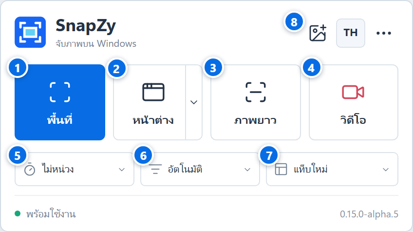
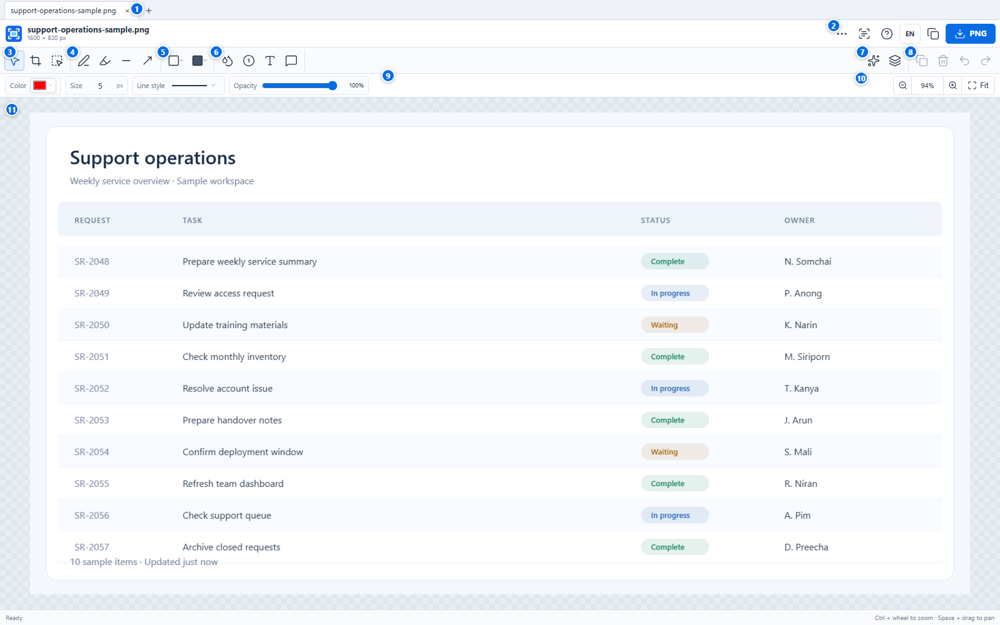

# SnapZy 0.15.0-alpha.17 User Guide

This guide describes the capture launcher and image editor in SnapZy Rust `0.15.0-alpha.10`. The screenshots use synthetic sample data created for this guide.

## Screen overview

### Capture launcher

| No. | Control | What it does |
| --- | --- | --- |
| 1 | **Area** | Drag to select a region to capture. |
| 2 | **Window** | Capture a target window. Use the adjacent arrow to choose the entire desktop. |
| 3 | **Scrolling** | Capture a scrollable area. Choose automatic or manual scrolling with control 6. |
| 4 | **Video** | Open recording options before recording. Choose a screen or window and select an audio source. |
| 5 | **Delay** | Choose 0, 3, 5, or 10 seconds for the next capture. |
| 6 | **Scrolling mode** | Choose automatic or manual scrolling. |
| 7 | **Open captures in** | Open captured images in a new tab or a new window. |
| 8 | **Header actions** | Open an image-editor window, switch between English and Thai, or open More. |

The More menu contains commands for the entire desktop, keyboard shortcuts, and SnapZy information.

### Image editor

| No. | Control | What it does |
| --- | --- | --- |
| 1 | **Document tabs** | Switch between open work. Use `+` to create a white 1024 × 768 blank canvas. |
| 2 | **Top commands** | More, Workspace size, Combine images, OCR, Help, language, Copy image, and Save PNG. |
| 3 | **Select / Crop / Duplicate area** | Select and edit objects, crop the image, or drag a region to create a movable image copy. |
| 4 | **Pen / Highlighter / Line / Arrow** | Choose a drawing tool and drag on the canvas. |
| 5 | **Outline / Filled shapes** | Open a menu to choose a rectangle or ellipse, then drag to draw it. |
| 6 | **Blur / Step / Text / Speech bubble** | Add an obscured region or an annotation. Text and speech bubbles open an entry dialog before placement. |
| 7 | **Effects / Layer order / Groups** | Set effects, arrange object order, and group or ungroup selected objects. |
| 8 | **Object and history actions** | Duplicate or delete the selected object, undo, or redo. |
| 9 | **Tool settings** | Adjust color, size, line style, font, text background, and opacity for the selected tool. |
| 10 | **Zoom and Fit** | Zoom in or out, choose a zoom level, or fit the full image in the workspace. |
| 11 | **Canvas** | Draw and edit the image. The checkerboard pattern indicates transparent areas. |

## Edit an image

1. Capture an image from the launcher, or choose **More → Open image** to open a PNG, JPEG, or BMP. Use `+` to create a blank canvas.
2. Choose a tool from the toolbar and drag on the canvas to create an object. For text and speech bubbles, enter the text in the dialog that appears.
3. After drawing, SnapZy returns to Select with the new object selected. Move or resize it, or change its color, size, line style, font, background, or opacity.
4. Use **Copy image** to copy the edited image, or **Save PNG** to export an image file.

## Group objects

1. With Select active, drag a rectangle from empty canvas space around the objects you want. Fully enclose each object.
2. Click **Group** or press `Ctrl+G`. Drag any member to move the group together.
3. Click **Ungroup** or press `Ctrl+Shift+G` to edit members separately. Grouping supports Undo/Redo and survives saving and reopening a `.snapzy` project.

## Combine open image tabs

1. Open at least two images in tabs in the same editor window.
2. Click **Combine images** (overlapping images icon) near **More**, or choose it from **More**.
3. Check the tabs to include, use the arrows to change their order, choose vertical, horizontal, or free placement, and set a gap of 0–500 px for automatic layouts.
4. Click **Combine images**. SnapZy opens a new tab. The source tabs remain unchanged, and their images and objects remain editable in the combined project. Save the new work as a `.snapzy` project to continue editing later.

## Zoom and keyboard shortcuts

- `Ctrl` + mouse wheel: zoom around the pointer
- `Space` + drag: pan the workspace
- Click the hand button beside zoom, then drag to pan without holding a key. Selecting a drawing tool returns to editing.
- Mouse wheel: scroll vertically; `Shift` + wheel: scroll horizontally. Middle-button drag also pans. Fit restores the full image; panning does not change image pixels or objects.
- `Ctrl` + `+` or `=`: zoom in; `Ctrl` + `-`: zoom out; `Ctrl` + `0`: fit the image
- `Ctrl` + `Z`: undo; `Ctrl` + `Shift` + `Z` or `Ctrl` + `Y`: redo
- `Ctrl` + `D`: duplicate the selected object; `Delete`: remove it
- `Enter`: apply a crop; `Esc`: dismiss a menu or cancel the current operation

## Resize the workspace

1. Open **More** and choose **Workspace**.
2. Enter the new width and height in pixels. The canvas expands to the right and bottom, or clips content outside the new boundary when reduced.
3. Click **Apply size**. The change is one Undo/Redo step and is included in the project save state.
4. When reducing either dimension, confirm the warning before applying. Use **Undo** to restore the previous workspace if needed.

To close every tab in the current editor window, choose **More → Close all tabs**.
Unsaved projects are handled together with **Save all**, **Discard all**, or **Cancel**. Cancel keeps all tabs open.
The Editor window X asks whether to close the active tab, close all tabs, or cancel.
Combined image groups preserve their proportions when resized, including with side handles.

Closing the capture launcher with X keeps SnapZy running in the System Tray.
Click the tray icon to reopen it, or right-click and choose **Exit** to quit.

## Alpha 15 limitations

The **OCR** and **Add Image** commands remain visible but are not connected in the Tauri Editor. **Open Project**, **Save**, and **Save As** use editable `.snapzy` project files. Copy image and Save PNG export a flattened image and do not mark the editable project as saved.
